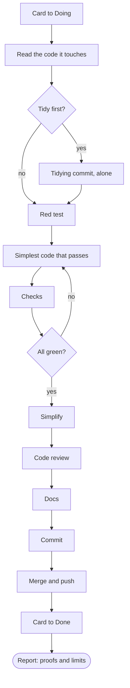

# Contributing to sideco

This page is the development cycle: how one card of the backlog becomes one
commit on `main`. How the code itself is written is in
[docs/coding-standards.md](docs/coding-standards.md).

The project is built with itself: the backlog and this cycle are boards in
sideco, and whoever works on a card, human or agent, moves it there.

## The cycle



1. **Card to Doing.** Take the card at the top of *To do*. Work in a git
   worktree of its own, never in the main clone: several sessions often work
   on the repository at once.

   ```bash
   git worktree add .claude/worktrees/<name> -b <name> origin/main
   ```

2. **Read the code it touches.** Often half the work: what the card asks for
   may already exist, missing only a word or a wire.
3. **Tidy first?** When the change would be easier in tidier code, tidy it in
   a commit of its own: no change of behaviour, tests unchanged and green.
4. **Red test.** Write the test before the code and see it fail, for the
   reason you expect. A behaviour the user sees gets an end-to-end test; a
   rule gets a unit test.
5. **Simplest code that passes.**
6. **Checks.** All of them, every time:

   ```bash
   bun run typecheck
   bun run lint
   bun run test
   bun test tests/e2e
   ```

   `bun run lint` runs Biome and markdownlint. Biome exits 0 with warnings:
   read their count, and leave it at 0. `bun install` also turns on a
   pre-commit hook (`.githooks/pre-commit`) that runs Biome on the staged
   files: an error blocks the commit, and its infos point at the long or
   tangled functions in what you touch.
7. **Simplify.** Read the diff: duplicates, names, and the
   [CUPID properties](docs/coding-standards.md#cupid).
8. **Code review.** A second reader, human or agent, who did not write it.
9. **Docs.** README, the guides and the agent skill, when the change shows
   there. The [PRD](docs/PRD.md) is a frozen history: it is not updated.
10. **Commit.** Stage the paths one by one. The message says what changed for
    the user, in the present tense, its first line a sentence. Never commit
    the workspace (`.sideco/`).
11. **Merge and push.** Rebase on `origin/main`, push the branch, wait for CI,
    then fast-forward `main` and remove the worktree:

    ```bash
    git merge --ff-only <name>
    git push origin main
    git worktree remove .claude/worktrees/<name>
    git branch -d <name>
    ```

    The CI tests a commit once: `main` moved forward to a commit its branch
    already had tested is not tested again, and its run says so.

    History is never rewritten on the remote: a branch that needs another
    push after a rebase is pushed under a new name.
12. **Card to Done.** Its detail says what was delivered, in which commit, and
    what is still open.

**Report.** The cycle ends on a report: the output of each command that
proves a claim, what was not verified, and what remains. "Done", "pushed" or
"green" is said only next to the output that shows it.
