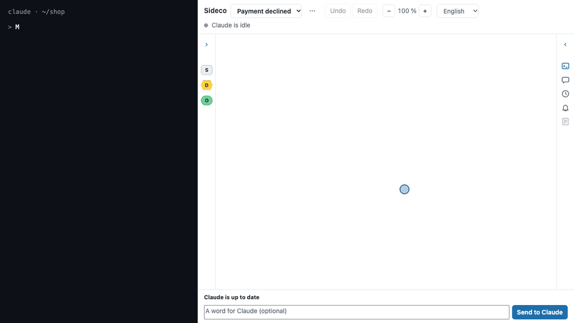
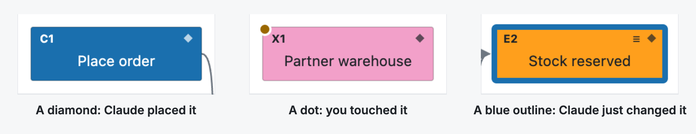
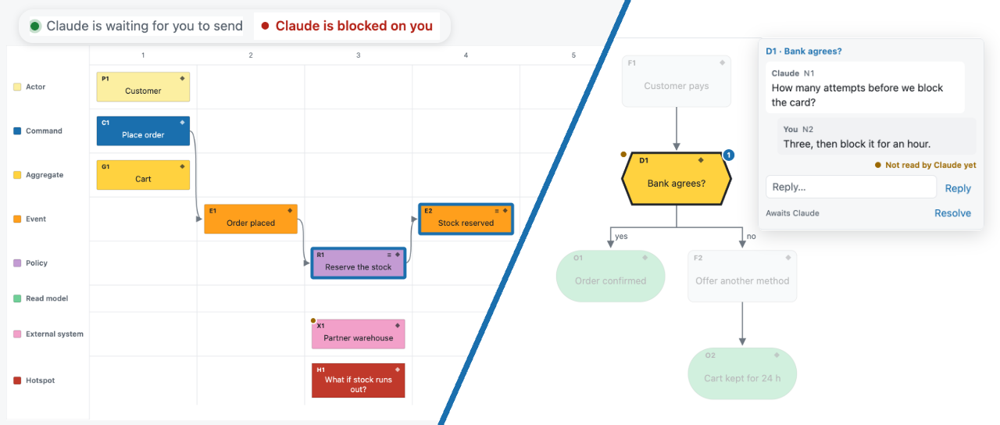

# Sideco

[](https://github.com/bastien-gallay/sideco/actions/workflows/ci.yml)

**Turn your coding agent's walls of text into a conversation you can see and reshape.**

A live, structured board beside the terminal: the agent lays out a flow, a backlog or an event storming; you answer right on the card in question; one click hands the turn back, and the agent reads what you changed. Local and MIT. Claude Code today; MCP for other agents on the roadmap.

<picture>
  <source media="(prefers-color-scheme: dark)" srcset="docs/img/sideco-loop-dark.gif">
  
</picture>

<sub>Filmed: you prompt in the terminal as before and answer on the board. The page and the commands are the real ones; the terminal is redrawn from what Claude receives.</sub>

> [!NOTE]
> Early: version 0.1.0, for one person per workspace, with one or more Claude Code sessions. [Tell me what breaks](https://github.com/bastien-gallay/sideco/issues).

## Install

You need Claude Code and [Bun](https://bun.sh) 1.4 or later, on macOS or Linux (Windows is untried). Claude Code installs the plugin straight from GitHub, no clone needed:

```sh
claude plugin marketplace add bastien-gallay/sideco && claude plugin install sideco@sideco
```

Run it in your terminal, not inside a session. `claude plugin list` then shows `sideco`. [What it adds to your machine](#on-your-machine) is listed below.

## Your first board

In any project, start Claude Code and ask:

```text
Let's model the checkout flow on the Sideco board
```

Claude creates the workspace (a `.sideco/` folder in the project), starts a local server and opens the board in your browser, at `http://127.0.0.1:4747`. The cards appear as Claude writes them. There is nothing else to launch. Claude runs the `sideco` commands this page names; ask for one in plain words, or [type it yourself](docs/guide.md#the-commands).

## One turn of the loop

You edit the board yourself: add, rename, drag, link, answer in a card's thread, undo. One click on **Send to Claude** hands the turn back. Each card shows what waits on it, and what Claude just changed:

<picture>
  <source media="(prefers-color-scheme: dark)" srcset="docs/img/sideco-marks-dark.png">
  
</picture>

| When you send, Claude | It reads your changes |
| --- | --- |
| waits for you | At once: the click wakes it |
| is working | After its current action |
| had stopped before the page was open | At your next message in the terminal |

## Workshops

Ask for one by its name, or let Claude choose from your question.

| Workshop | The question it asks |
| --- | --- |
| Event storming | What happens in the domain, in what order? |
| Flow | Which way do we go, and where does the path split? |
| Kanban | Where is the work, and what blocks it? |
| Story map | Which journey, and what do we ship first? |
| Retrospective | What do we keep, stop and try? |
| Impact / Effort | What do we do first, for what it brings and what it costs? |
| C4 context | Who uses the system, and what does it depend on? |

<picture>
  <source media="(prefers-color-scheme: dark)" srcset="docs/img/sideco-two-workshops-dark.png">
  
</picture>

<sub>An event storming and a flow, cut side by side. On the flow, Claude asked a question on a card and the answer sits in its thread.</sub>

To show a board to your team, export it to Markdown, HTML, SVG, Mermaid or JSON, or let `sideco publish` turn every board into a static site. [Each workshop has its picture in the guide](docs/guide.md#workshops).

## On your machine

- **What is installed.** A skill, and hooks that run a local command on the events of a session: that is how the board shows what Claude does and how your edits reach it. Outside a Sideco workspace they exit at once.
- **What keeps running.** A server on `127.0.0.1` only, which refuses requests from another origin and stops by itself 5 minutes after the last page and session leave. At the end of a turn one hook stays parked, for 12 hours at most, to wake Claude when you send.
- **Where your data goes.** Sideco sends nothing anywhere and has no telemetry. What Claude reads of a board goes where the rest of your Claude Code session goes.
- **Where it is kept.** Every change is an event in an append-only log, `.sideco/boards.jsonl`, in your project; undo, redo and the board's history come from it. Commit it and the board's history travels with the code. One writer at a time: two people who edit it each on their side get a merge conflict.

## If something goes wrong

Ask Claude in plain words, or name the command.

| What you see | What to do |
| --- | --- |
| Claude answers in the terminal and no board opens | Name it: *"on the Sideco board"*. If nothing changes, start Claude Code again and check that `claude plugin list` shows `sideco` |
| The page did not open | Ask Claude to run `sideco url`: it prints the address to open, `http://127.0.0.1:4747` unless that port was taken |
| Claude reports `this shell may not connect to the companion` | Claude Code's sandbox blocks local connections: let Claude run the command outside it, or [allow them once](docs/guide.md#with-claude-codes-sandbox) |
| `sideco: Sideco runs on Bun 1.4 or later, not found` | Install [Bun](https://bun.sh), then start Claude Code again. An older Bun is not detected: check with `bun --version` |
| The board is stuck or out of date | Ask Claude to run `sideco stop`, then `sideco url`: the server starts again from the same log |
| You want it gone | `claude plugin uninstall sideco@sideco`; the `.sideco/` folder of each project is yours to keep or delete |

Anything else: [open an issue](https://github.com/bastien-gallay/sideco/issues), with the output of `sideco status`.

## Learn more

| Document | What is in it |
| --- | --- |
| [Guide](docs/guide.md) | Other ways to install, the gestures of the page, every workshop, the commands, the sandbox, known limits |
| [Guide détaillé](docs/guide.fr.md), in French | The same and more: the full CLI, labels, search, the data format |
| [Contributing](CONTRIBUTING.md) | How to work on Sideco, with links to the coding standards and the PRD |

The code is under the [MIT](LICENSE) license.
