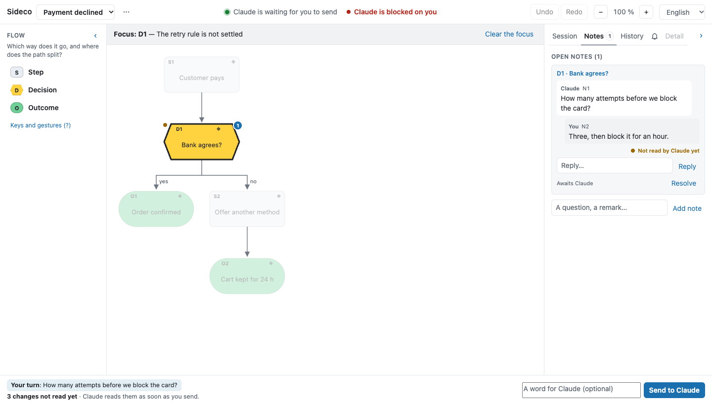
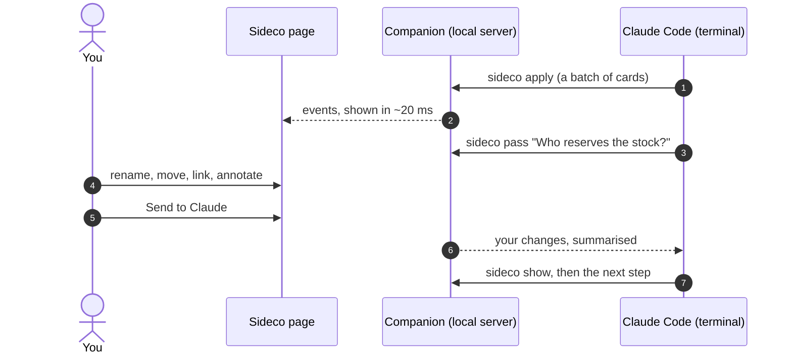
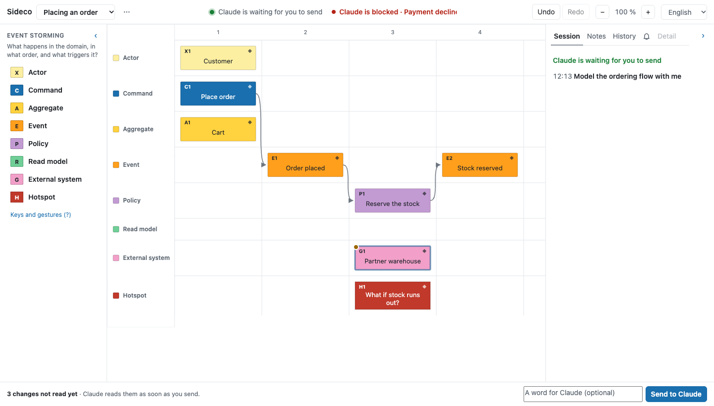
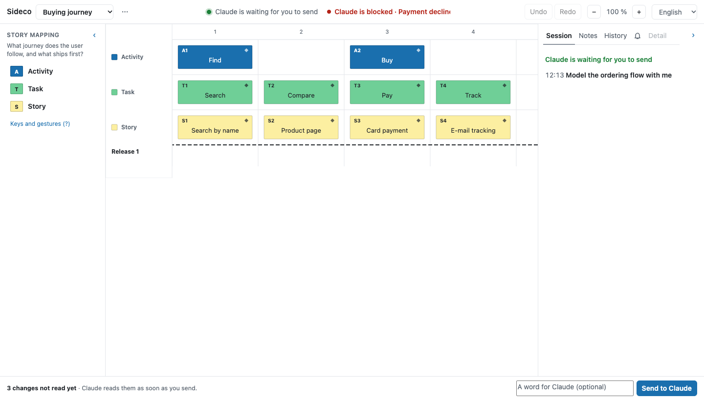
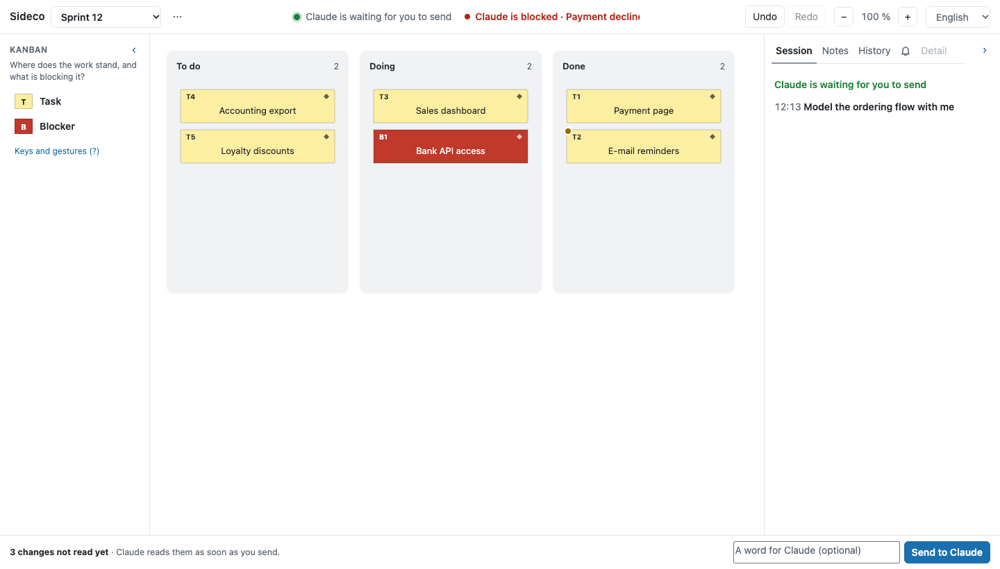

# Sideco

[](https://github.com/bastien-gallay/sideco/actions/workflows/ci.yml)

**Turn your coding agent's walls of text into a conversation you can see and reshape.**

A live, structured board beside the terminal: the agent lays out a flow, a backlog or an event storming; you answer right on the card in question; one click hands the turn back, and the agent reads what you changed. Local and MIT. Claude Code today; MCP for other agents on the roadmap.

> [!NOTE]
> Early: version 0.1.0. One person and one active agent per workspace; two people editing the same `boards.jsonl` will get a merge conflict. [Tell me what breaks](https://github.com/bastien-gallay/sideco/issues).


<sub>A diamond marks a card Claude placed, a dot one you touched, a blue outline what Claude just changed.</sub>

## Install

You need Claude Code and [Bun](https://bun.sh) 1.4 or later; Sideco has no other runtime dependency. Claude Code installs the plugin straight from GitHub, no clone needed:

```sh
claude plugin marketplace add bastien-gallay/sideco && claude plugin install sideco@sideco
```

Without Bun yet, install it first, in the same line:

```sh
curl -fsSL https://bun.sh/install | bash && claude plugin marketplace add bastien-gallay/sideco && claude plugin install sideco@sideco
```

Then, in any project, start Claude Code and ask: *"let's model the checkout flow on the board"*. Claude creates the workspace, starts the companion and opens the page. There is nothing else to launch.

To keep the companion's address in sight, put it in Claude Code's status line: it shows `sideco · 127.0.0.1:4747`, a link where the terminal supports one, and nothing outside a Sideco project. A plugin cannot set the status line; ask Claude to run `sideco statusline --install`, which writes it into `~/.claude/settings.json`. A status line of your own is left as it is: the command prints the two lines to append to your script instead.

To try a clone without installing it, pass the plugin for one session:

```sh
git clone https://github.com/bastien-gallay/sideco.git ~/sideco
claude --plugin-dir ~/sideco
```

## The loop





<sub>Source: `src/server/http.ts`, `src/cli/hook.ts`. Latency measured by `tests/e2e/companion.test.ts`.</sub>

One click on **Send to Claude** hands the turn back, and the bar at the bottom of the page says when Claude will read your changes: as soon as you send when it waits for you (it is woken up), after its current action when it works, at your next message in the terminal when it stopped before the page was open. The summary is net of back-and-forth: a card added then renamed reads as one addition.

## Workshops

| Workshop | The question it asks |
| --- | --- |
| `event-storming` | What happens in the domain, in what order? |
| `flow` | Which way do we go, and where does the path split? |
| `kanban` | Where is the work, and what blocks it? |
| `story-map` | Which journey, and what do we ship first? |
| `retro` | What do we keep, stop and try? |
| `impact-effort` | What do we do first, for what it brings and what it costs? |
| `c4-context` | Who uses the system, and what does it depend on? |

Every board exports to Markdown, HTML, SVG, Mermaid or JSON, and `sideco publish` turns all of them into a static site.



| Story map | Kanban |
| --- | --- |
|  |  |

## Your data stays local

- Everything is an event in an append-only log, `.sideco/boards.jsonl`, in your project. Commit it: the board's history travels with the code.
- The companion listens on `127.0.0.1` only and refuses requests from another origin.
- Undo, redo and a history slider come from the same log.

## If something goes wrong

Sideco's commands are run by Claude: ask it in plain words, or name the command.

| What you see | What to do |
| --- | --- |
| The page did not open | Ask Claude to run `sideco url`: it prints the address to open, `http://127.0.0.1:4747` by default |
| Bun is missing or older than 1.4 | Install [Bun](https://bun.sh), then start Claude Code again |
| The board is stuck or out of date | Ask Claude to run `sideco stop`, then `sideco url`: the companion starts again from the same log |
| You want it gone | `claude plugin uninstall sideco@sideco`; the `.sideco/` folder of each project is yours to keep or delete |

Anything else: [open an issue](https://github.com/bastien-gallay/sideco/issues), with the output of `sideco status`.

## Learn more

To use it:

| Document | What is in it |
| --- | --- |
| `sideco help` | The full command list |
| In French: [detailed guide](docs/guide.fr.md) | Every gesture in the page, the CLI, the Claude Code sandbox, known limits |

To work on it:

| Document | What is in it |
| --- | --- |
| [Contributing](CONTRIBUTING.md) | The development cycle: from a card of the backlog to a commit on `main` |
| [Coding standards](docs/coding-standards.md) | How the code is written: CUPID, a functional core, onion architecture, DDD, event sourcing |
| [To investigate](docs/to-investigate.md) | Oddities seen once and not yet understood, with what was already ruled out |
| In French: [PRD](docs/PRD.md) | Why Sideco is built the way it is |

## Feedback and license

Sideco is young and built by one person: what you tried, what confused you and what broke are all worth [an issue](https://github.com/bastien-gallay/sideco/issues). The code is under the [MIT](LICENSE) license.
