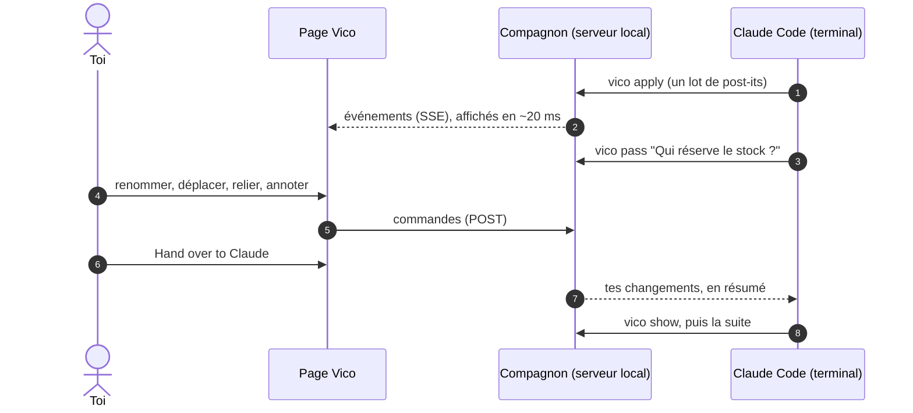
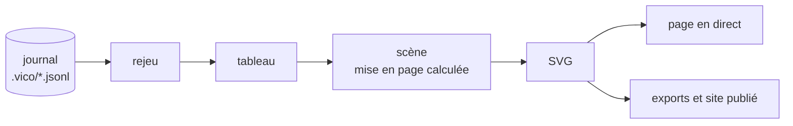

# Vico

Vico est le compagnon visuel de Claude Code : une page web locale, ouverte à côté du terminal, où toi et ton agent construisez le même modèle (event storming, flux, kanban, story map, rétrospective) pendant que l'agent travaille.


<sub>Source : capture du test de bout en bout `tests/e2e/companion.test.ts`, le 2026-11-18. Le losange en haut d'une carte marque une carte posée par Claude, le point une carte posée par toi ; le contour bleu signale ce qui vient de changer.</sub>

**Complète** le terminal, ne le remplace pas : la conversation reste dans Claude Code.

| Où | Ce qui s'y fait |
| --- | --- |
| Terminal (Claude Code) | Prompts, réponses, permissions, code : inchangé |
| Page Vico | Modifier le tableau, épingler une note, passer la main ; suivre la session en lecture seule |
| ❌ Hors périmètre | Saisir un prompt dans la page, piloter le terminal, relire tout le transcript |

## Démarrer

Il faut [Bun](https://bun.sh) 1.4 ou plus récent. Aucune autre dépendance à l'exécution.

```sh
# Dans ton projet : lance Claude Code avec le plugin
cd /chemin/vers/ton-projet
claude --plugin-dir /chemin/vers/visual-companion
```

Demande ensuite, dans le terminal : « modélisons le passage de commande sur le tableau ». Tu n'as rien d'autre à lancer :

| Étape | Qui | Comment |
| --- | --- | --- |
| Créer l'espace de travail `.vico/` | Claude | `vico open`, première étape du skill |
| Démarrer le compagnon | Claude, ou le plugin au début de chaque session suivante | `vico open`, hook `SessionStart` |
| Ouvrir la page dans ton navigateur | Claude | `vico open` ; une page déjà ouverte est laissée telle quelle |
| Poser les premiers post-its | Claude | `vico apply` |

Tu peux aussi l'ouvrir toi-même, à tout moment : `/chemin/vers/visual-companion/bin/vico open`. La variable `BROWSER` choisit le navigateur.

Pour ne plus passer `--plugin-dir` à chaque fois, installe le plugin une fois ; le dépôt est sa propre place de marché :

```sh
claude plugin marketplace add /chemin/vers/visual-companion
claude plugin install vico@vico
```

Claude Code copie alors le plugin dans son cache : après une modification du dépôt, monte la version dans `.claude-plugin/` puis lance `claude plugin marketplace update vico` et `claude plugin update vico@vico`. Pendant que tu développes Vico, `--plugin-dir` reste le plus direct.

Pour taper `vico` sans son chemin dans ton propre terminal, pose un lien : `ln -s /chemin/vers/visual-companion/bin/vico ~/.local/bin/vico`. Dans la session Claude Code, le plugin le met déjà sur le `PATH`.

## La boucle

**Lis** le schéma comme un tour de table : chacun modifie le tableau, puis passe la main.



<sub>Source : `src/server/http.ts`, `src/cli/hook.ts` ; latence mesurée par `tests/e2e/companion.test.ts` (22 ms le 2026-11-18, sur cette machine).</sub>

Tes changements reviennent à Claude par quatre canaux, selon ce qu'il fait à ce moment-là :

| Claude… | Canal | État |
| --- | --- | --- |
| attend ta réponse (`vico wait`) | la commande se débloque et affiche le résumé | ✅ testé |
| reçoit ton prochain message | le résumé est joint au contexte (hook `UserPromptSubmit`) | ✅ testé |
| est en train de travailler | le résumé arrive après son outil en cours (hook `PostToolUse`), si tu as passé la main | ✅ testé |
| est au repos, page ouverte | il est réveillé (hook `Stop` avec `asyncRewake`) | ✅ essayé en session réelle, Claude Code 2.1.326 |

Le résumé est net des allers-retours : un post-it ajouté puis renommé se lit comme un seul ajout. Signes : `+` ajouté, `−` supprimé, `~` modifié, `→` déplacé.

## Dans la page

| Geste | Effet |
| --- | --- |
| Cliquer un type dans la palette | Ajoute un post-it à la suite (ou relié au nœud sélectionné, dans un flux) |
| Double-cliquer une case vide | Ajoute un post-it à cet endroit |
| Double-cliquer une carte | La renomme |
| Glisser une carte | La change d'étape ou de colonne ; la position reste sémantique, jamais en pixels |
| Sélectionner une carte | Barre d'actions : renommer, détail, relier, note pour Claude, supprimer |
| Curseur d'historique, en bas | Remonte le temps, en lecture seule ; `Back to live` y revient |
| `Export` | Markdown, HTML, SVG, Mermaid ou modèle JSON du tableau courant, dans la langue de la page |
| `Hand over to Claude` | Envoie tes changements, avec un mot facultatif |
| Sélecteur `English` / `Français`, en haut à droite | Change la langue de la page ; le choix est gardé par ce navigateur |

### Langue

La page, le dessin et les exports sont en anglais par défaut ; le français est l'autre langue fournie. Ce que tu écris sur un post-it n'est jamais traduit.

| Qui lit | Langue | Comment la changer |
| --- | --- | --- |
| Toi, dans la page | anglais | le sélecteur de la page (gardé par le navigateur) ; `VICO_LANG=fr` au démarrage du compagnon change la langue d'ouverture |
| Le lecteur d'un export ou du site publié | anglais | `--lang fr` sur `vico export` et `vico publish`, ou `VICO_LANG=fr` |
| L'agent, dans le terminal (`vico show`, `vico changes`, erreurs) | anglais, toujours | ne se change pas : un seul vocabulaire à apprendre pour l'agent |

<sub>Source : `src/domain/i18n.ts`, `src/web/messages.ts`, `src/cli/main.ts` (`language`) ; `tests/unit/i18n.test.ts`, `tests/integration/cli.test.ts`, `tests/e2e/companion.test.ts`, exécutés le 2026-11-18.</sub>

## Les ateliers

Un atelier est une donnée (`src/domain/formats.ts`), pas un moteur de rendu : types de post-its, couleurs, mise en page.

| Atelier | Question posée | Mise en page | Types (préfixe des identifiants) |
| --- | --- | --- | --- |
| `event-storming` | Que se passe-t-il dans le domaine, dans quel ordre ? | étapes | `actor` `X`, `command` `C`, `aggregate` `A`, `event` `E`, `policy` `P`, `readmodel` `R`, `system` `G`, `hotspot` `H` |
| `flow` | Par où passe-t-on, où le chemin se sépare-t-il ? | graphe | `step` `S`, `decision` `D`, `outcome` `O` |
| `kanban` | Où en est le travail, qu'est-ce qui le bloque ? | colonnes | `task` `T`, `blocker` `B` |
| `story-map` | Quel parcours, que livre-t-on d'abord ? | étapes | `activity` `A`, `task` `T`, `story` `S` |
| `retro` | Que garde-t-on, qu'arrête-t-on, qu'essaie-t-on ? | colonnes | `point` `K`, `action` `A` |

<sub>Source : `vico formats`.</sub>

## La ligne de commande

`vico help` donne la liste complète. L'essentiel :

```sh
vico open                       # démarre le compagnon et ouvre la page, si elle ne l'est pas déjà
vico status                     # tableaux, session, serveur
vico show                       # le tableau en texte, comme l'agent le lit
vico export --format md -o docs/design/commande.md
vico export --format md --lang fr   # le même, en français
vico board rm brouillon         # supprime un tableau ; son histoire reste dans le journal
vico publish                    # tous les tableaux en site statique, sous .vico/site
vico stop                       # arrête le compagnon ; le journal reste
```

L'agent, lui, écrit par lots, tout ou rien :

```sh
vico apply <<'EOF'
board new "Passage de commande" --format event-storming
add command "Passer commande" --col 1
add event "Commande passée" --col 1
link C1 E1
EOF
```

## Les données

Tout est un événement dans un journal en ajout seul ; le tableau, l'historique et les exports en sont des projections.



<sub>Source : `src/domain/` (`replay.ts`, `layout/`, `render/svg.ts`). Le même peintre SVG sert la page et les exports.</sub>

| Fichier | Contenu | Git |
| --- | --- | --- |
| `.vico/boards.jsonl` | L'histoire des tableaux | ✅ à versionner |
| `.vico/sessions.jsonl` | La trace des sessions : prompts, outils lancés, tâches | ❌ ignoré (local) |
| `.vico/server.json` | L'adresse du compagnon en cours | ❌ ignoré |
| `.vico/site/` | Le site publié | ❌ ignoré |

Le compagnon n'écoute que sur `127.0.0.1` et refuse les requêtes d'une autre origine.

## Avec le bac à sable de Claude Code

Par défaut, le bac à sable de Bash bloque les connexions locales, et il interdit toujours d'ouvrir un navigateur. Les hooks du plugin n'y sont pas soumis ; les commandes `vico` de l'agent, si.

| Commande de l'agent | Bac à sable par défaut | Avec `allowLocalBinding` |
| --- | --- | --- |
| `vico boards`, `vico show`, `vico status`, `vico export` | ✅ elles lisent le journal | ✅ |
| `vico apply`, `vico add`, `vico pass`, `vico wait`… | ❌ `this shell may not connect to the companion` | ✅ |
| `vico open`, compagnon démarré par le plugin (hors bac à sable) | ❌ même message | ✅ le compagnon ouvre la page à la place du shell |
| `vico open`, compagnon démarré par ce shell (premier usage dans un projet) | ❌ refusé ; ⚠️ le message `this shell may not start the companion` n'est vérifié qu'en test unitaire | ⚠️ le compagnon démarre, la page ne s'ouvre pas : `could not open the browser` |

<sub>Source : essais du 2026-11-18 dans une session Claude Code 2.1.326 sous bac à sable, `allowLocalBinding` activé ; colonne « par défaut » constatée le 2026-11-17.</sub>

Sur un ❌ ou un ⚠️, l'agent relance la commande hors du bac à sable (le skill le lui dit), ce qui peut demander ton accord. Le réglage qui l'évite presque toujours, dans `settings.json` :

```json
{
  "sandbox": {
    "network": { "allowLocalBinding": true }
  }
}
```

⚠️ Non essayé : `"excludedCommands": ["vico *"]`, qui d'après la documentation de Claude Code ([sandboxing](https://code.claude.com/docs/en/sandboxing), lue le 2026-11-17) sort `vico` du bac à sable et lèverait aussi le dernier cas.

## Développer

```sh
bun test tests/unit          # domaine, serveur, CLI, hooks, vues : sans réseau
bun test tests/integration   # le vrai binaire, un vrai port
bun test tests/e2e           # la page dans Chrome (playwright-core, Chrome installé)
bun run typecheck && bun run lint
```

| Niveau | Ce qu'il prouve | Tests | Hors bac à sable |
| --- | --- | --- | --- |
| Unitaire | Règles du domaine, mise en page, exports, hooks, contrat du plugin, textes des deux langues | 378 | non |
| Intégration | `bin/vico` de bout en bout : serveur, lots, attente, hooks par stdin, publication, suppression, ouverture de la page, langue des exports et de la page servie | 34 | oui (port local) |
| Bout en bout | La page dans Chrome : ajout, glisser, renommer, notes, historique, passage de main, suppression, redémarrage, bascule de langue | 27 | oui (navigateur) |

<sub>Source : exécution du 2026-11-18 sur cette machine (Bun 1.4.4, macOS).</sub>

Le code suit le découpage du domaine :

| Dossier | Rôle |
| --- | --- |
| `src/domain/` | Événements, commandes, règles, ateliers, mise en page, rendu SVG, exports. Pur, sans entrée-sortie |
| `src/server/` | Journal, diffusion des événements, HTTP et SSE |
| `src/cli/` | La commande `vico` et le traitement des hooks |
| `src/web/` | La page : TypeScript sans framework, assemblée en un seul fichier HTML |
| `hooks/`, `skills/`, `.claude-plugin/` | Le plugin Claude Code |

Le pourquoi des choix est dans [docs/PRD.md](docs/PRD.md).

## Limites connues

- ⚠️ Le contenu de `TodoWrite` n'est pas documenté côté hooks : les tâches sont lues prudemment, et peuvent manquer dans le panneau de session.
- ⚠️ Deux personnes qui modifient `.vico/boards.jsonl` chacune de leur côté auront un conflit de fusion : le multi-utilisateur n'est pas traité.
- Le compagnon démarré automatiquement reste en marche après la session : `vico stop` l'arrête.
- Une session sans interface (`claude -p`) n'est jamais réveillée par un passage de main : elle doit pouvoir se terminer.
- Un tableau se supprime depuis le terminal (`vico board rm ID`, ou en le demandant à Claude) ; la page n'a pas encore de bouton pour cela.
- Un utilisateur, un agent actif par espace de travail. Pas d'annuler/rétablir : l'historique se consulte, il ne se rejoue pas encore.
