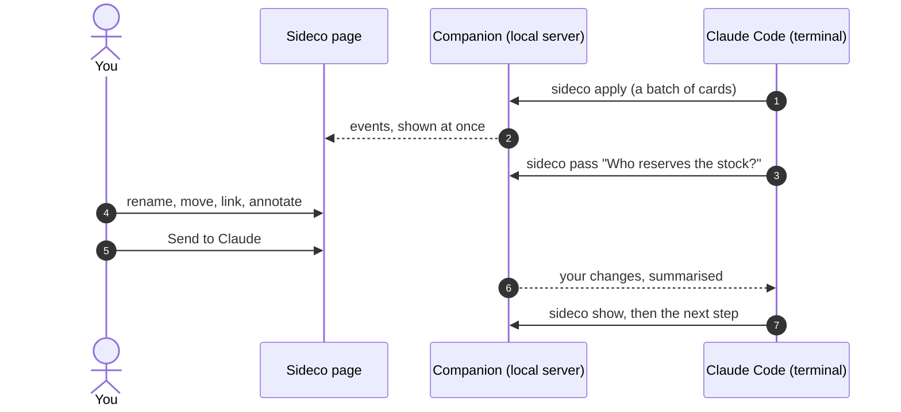

# Sideco

[](https://github.com/bastien-gallay/sideco/actions/workflows/ci.yml)

**Turn your coding agent's walls of text into a conversation you can see and reshape.**

A live, structured board beside the terminal: the agent lays out a flow, a backlog or an event storming; you answer right on the card in question; one click hands the turn back, and the agent reads what you changed. Local and MIT. Claude Code today; MCP for other agents on the roadmap.


<sub>A diamond marks a card Claude placed, a dot one you touched, a blue outline what Claude just changed.</sub>

> [!NOTE]
> Early: version 0.1.0, for one person and one active agent per workspace. [Tell me what breaks](https://github.com/bastien-gallay/sideco/issues).

## Install

You need Claude Code and [Bun](https://bun.sh) 1.4 or later, on macOS or Linux (Windows is untried); Sideco has no other runtime dependency. Claude Code installs the plugin straight from GitHub, no clone needed:

```sh
claude plugin marketplace add bastien-gallay/sideco && claude plugin install sideco@sideco
```

The plugin adds a skill, and hooks that run a local command on the events of a session (your prompts, Claude's tool calls and tasks, the end of a turn): that is how the board shows what Claude does and how your edits reach it. The hooks talk to a server on `127.0.0.1` only, and exit at once outside a Sideco workspace.

<details>
<summary>Without Bun yet</summary>

Install it first, in the same line:

```sh
curl -fsSL https://bun.sh/install | bash && claude plugin marketplace add bastien-gallay/sideco && claude plugin install sideco@sideco
```

</details>

### Your first board

In any project, start Claude Code and ask:

```text
Let's model the checkout flow on the board
```

Claude creates the workspace (a `.sideco/` folder in the project), starts the companion (a local server) and opens the page in your browser, at `http://127.0.0.1:4747`. The cards appear as Claude writes them. There is nothing else to launch.

<details>
<summary>Keep the companion's address in the status line</summary>

Claude Code's status line can show `sideco · 127.0.0.1:4747`, a link where the terminal supports one, and nothing outside a Sideco project. A plugin cannot set the status line; ask Claude to run `sideco statusline --install`, which writes it into `~/.claude/settings.json`. A status line of your own is left as it is: the command prints the two lines to append to your script instead.

</details>

<details>
<summary>Try a clone without installing it</summary>

Pass the plugin for one session:

```sh
git clone https://github.com/bastien-gallay/sideco.git ~/sideco
claude --plugin-dir ~/sideco
```

</details>

## The loop




<sub>Source: `src/server/http.ts`, `src/cli/hook.ts`. `tests/e2e/companion.test.ts` checks that a write shows in the page, and that a send wakes Claude, in under 500 ms.</sub>

One click on **Send to Claude** hands the turn back. The bar at the bottom of the page says when Claude will read your changes:

| When you send, Claude | It reads your changes |
| --- | --- |
| waits for you | At once: the click wakes it |
| is working | After its current action |
| had stopped before the page was open | At your next message in the terminal |

What Claude receives is net of back-and-forth: a card added then renamed reads as one addition.

## In the page

You edit the board yourself; you do not only comment on it.

| Gesture | Effect |
| --- | --- |
| Click a type in the palette | Adds a card of that type |
| Double-click a card | Renames it |
| Drag a card | Moves it to another step or column, or within its cell |
| Select a card | Opens its action bar: rename, detail, link, note for Claude, remove |
| Reply in the Notes tab | Answers Claude in the thread of the card; `⌘` / `Ctrl` + Enter sends the reply and hands the turn back |
| Undo and Redo, or `⌘Z` / `Ctrl+Z` | Takes back your last gesture, never one of Claude's |
| `?` | Lists every key and gesture of the board on screen |

## Workshops

| Workshop | The question it asks |
| --- | --- |
| `event-storming` | What happens in the domain, in what order? |
| `flow` | Which way do we go, and where does the path split? |
| `kanban` | Where is the work, and what blocks it? |
| `story-map` | Which journey, and what do we ship first? |
| `retro` | What do we keep, stop and try? |
| `impact-effort` | What do we do first, for what it brings and what it costs? |
| `c4-context` | Who uses the system, and what does it depend on? |

Every board exports to Markdown, HTML, SVG, Mermaid or JSON, and `sideco publish` turns all of them into a static site.


## Your data stays local

- Everything is an event in an append-only log, `.sideco/boards.jsonl`, in your project. Commit it: the board's history travels with the code. One writer at a time: two people who edit it each on their side get a merge conflict.
- The companion listens on `127.0.0.1` only and refuses requests from another origin.
- Undo, redo and a history slider come from the same log.

## If something goes wrong

Sideco's commands are run by Claude: ask it in plain words, or name the command.

| What you see | What to do |
| --- | --- |
| Claude answers in the terminal and no board opens | Say it: *"on the Sideco board"*. If nothing changes, `claude plugin list` must show `sideco`; start Claude Code again after installing |
| The page did not open | Ask Claude to run `sideco url`: it prints the address to open, `http://127.0.0.1:4747` unless that port was taken |
| Claude reports `this shell may not connect to the companion` | Claude Code's sandbox blocks local connections: let Claude run the command outside it, or set `"sandbox": { "network": { "allowLocalBinding": true } }` in Claude Code's `settings.json` |
| `sideco: Sideco runs on Bun 1.4 or later, not found` | Install [Bun](https://bun.sh), then start Claude Code again. An older Bun is not detected: check with `bun --version` |
| The board is stuck or out of date | Ask Claude to run `sideco stop`, then `sideco url`: the companion starts again from the same log |
| You want it gone | `claude plugin uninstall sideco@sideco`; the `.sideco/` folder of each project is yours to keep or delete |

Anything else: [open an issue](https://github.com/bastien-gallay/sideco/issues), with the output of `sideco status`.

## Known limits

- One person and one active agent per workspace.
- The companion stops by itself 5 minutes after the last page and the last session left it; Claude starts it again at the next session.
- A Claude that waited more than 12 hours is no longer woken by a send: the page says so, and it reads your changes at your next message in the terminal.
- A session without an interface (`claude -p`) is never woken by a send.

## Learn more

To use it:

| Document | What is in it |
| --- | --- |
| `sideco help` | The full command list |
| In French for now: [detailed guide](docs/guide.fr.md) | Every gesture in the page, the CLI, the Claude Code sandbox, every known limit |

To work on it:

| Document | What is in it |
| --- | --- |
| [Contributing](CONTRIBUTING.md) | The development cycle: from a card of the backlog to a commit on `main` |
| [Coding standards](docs/coding-standards.md) | How the code is written: CUPID, a functional core, onion architecture, DDD, event sourcing |
| [To investigate](docs/to-investigate.md) | Oddities seen once and not yet understood, with what was already ruled out |
| In French: [PRD](docs/PRD.md) | Why Sideco is built the way it is |

## Feedback and license

Sideco is young and built by one person: what you tried, what confused you and what broke are all worth [an issue](https://github.com/bastien-gallay/sideco/issues). The code is under the [MIT](LICENSE) license.
