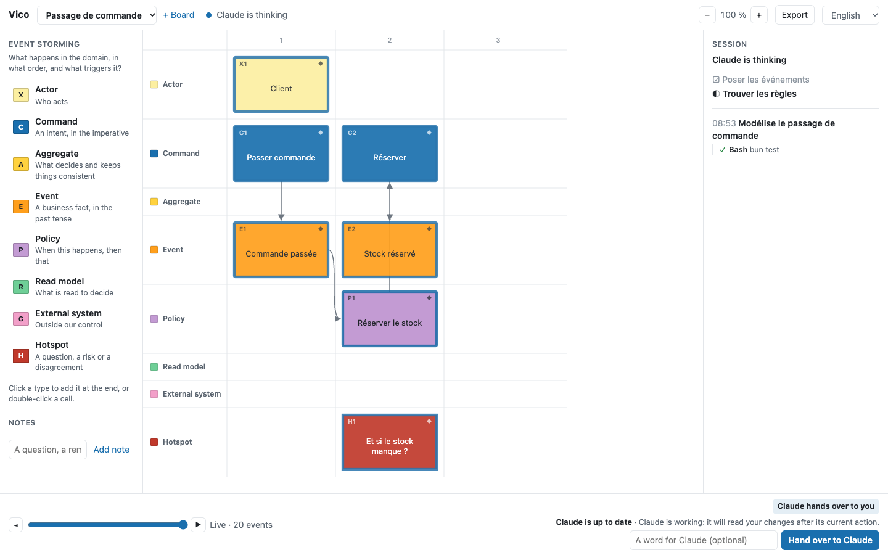
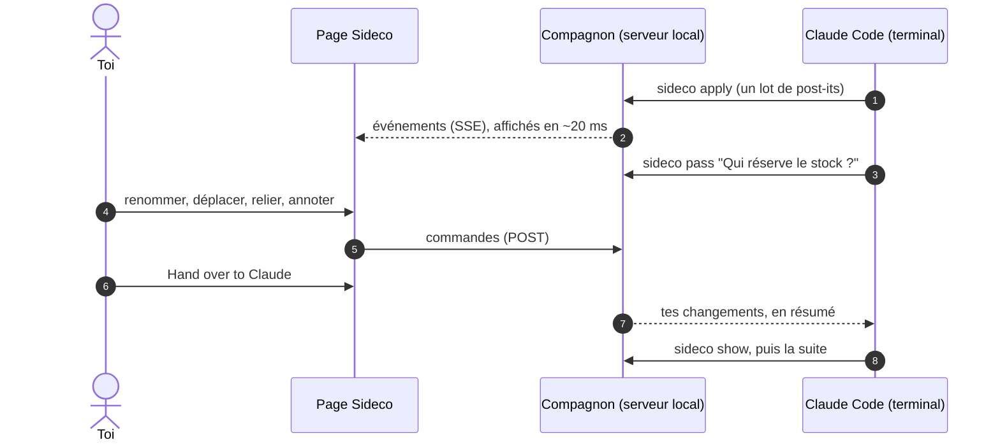
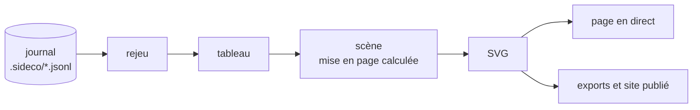

# Sideco

Sideco est le compagnon visuel de Claude Code : une page web locale, ouverte à côté du terminal, où toi et ton agent construisez le même modèle (event storming, flux, kanban, story map, rétrospective, impact / effort) pendant que l'agent travaille.



<sub>Source : capture du test de bout en bout `tests/e2e/companion.test.ts`, le 2026-11-18. Le losange en haut d'une carte marque une carte posée par Claude, le point une carte posée par toi ; le contour bleu signale ce qui vient de changer.</sub>

**Complète** le terminal, ne le remplace pas : la conversation reste dans Claude Code.

| Où | Ce qui s'y fait |
| --- | --- |
| Terminal (Claude Code) | Prompts, réponses, permissions, code : inchangé |
| Page Sideco | Modifier le tableau, épingler une note, passer la main ; suivre la session en lecture seule |
| ❌ Hors périmètre | Saisir un prompt dans la page, piloter le terminal, relire tout le transcript |

## Démarrer

Il faut [Bun](https://bun.sh) 1.4 ou plus récent. Aucune autre dépendance à l'exécution.

```sh
# Dans ton projet : lance Claude Code avec le plugin
cd /chemin/vers/ton-projet
claude --plugin-dir /chemin/vers/visual-companion
```

Demande ensuite, dans le terminal : « modélisons le passage de commande sur le tableau ». Tu n'as rien d'autre à lancer :

| Étape | Qui | Comment |
| --- | --- | --- |
| Créer l'espace de travail `.sideco/` | Claude | `sideco open`, première étape du skill |
| Démarrer le compagnon | Claude, ou le plugin au début de chaque session suivante | `sideco open`, hook `SessionStart` |
| Ouvrir la page dans ton navigateur | Claude | `sideco open` ; une page déjà ouverte est laissée telle quelle, y compris après un redémarrage du compagnon : la commande attend jusqu'à 8 s que l'onglet resté ouvert se reconnecte avant d'en ouvrir un autre |
| Poser les premiers post-its | Claude | `sideco apply` |

Tu peux aussi l'ouvrir toi-même, à tout moment : `/chemin/vers/visual-companion/bin/sideco open`. La variable `BROWSER` choisit le navigateur.

Pour ne plus passer `--plugin-dir` à chaque fois, installe le plugin une fois ; le dépôt est sa propre place de marché :

```sh
claude plugin marketplace add /chemin/vers/visual-companion
claude plugin install sideco@sideco
```

Claude Code copie alors le plugin dans son cache : après une modification du dépôt, monte la version dans `.claude-plugin/` puis lance `claude plugin marketplace update sideco` et `claude plugin update sideco@sideco`. Pendant que tu développes Sideco, `--plugin-dir` reste le plus direct.

Une page restée ouverte suit la mise à jour : quand le compagnon redémarre avec une autre page que celle de l'onglet, l'onglet se recharge de lui-même. Si tu es en train d'écrire (réponse non envoyée, champ rempli, dialogue ouvert), il attend : il affiche « Sideco was updated. » avec le bouton `Reload`, et se recharge de lui-même dès que plus rien n'est à perdre, par exemple une fois la réponse envoyée.

Pour taper `sideco` sans son chemin dans ton propre terminal, pose un lien : `ln -s /chemin/vers/visual-companion/bin/sideco ~/.local/bin/sideco`. Dans la session Claude Code, le plugin le met déjà sur le `PATH`.

## La boucle

**Lis** le schéma comme un tour de table : chacun modifie le tableau, puis passe la main.



<sub>Source : `src/server/http.ts`, `src/cli/hook.ts` ; latence mesurée par `tests/e2e/companion.test.ts` (22 ms le 2026-11-18, sur cette machine).</sub>

Tes changements reviennent à Claude par quatre canaux, selon ce qu'il fait à ce moment-là :

| Claude… | Canal | État |
| --- | --- | --- |
| attend ta réponse (`sideco wait`) | la commande se débloque et affiche le résumé | ✅ testé |
| reçoit ton prochain message | le résumé est joint au contexte (hook `UserPromptSubmit`) | ✅ testé |
| est en train de travailler | le résumé arrive après son outil en cours (hook `PostToolUse`), si tu as passé la main | ✅ testé |
| est au repos, page ouverte | il est réveillé (hook `Stop` avec `asyncRewake`), jusqu'à 12 h après son dernier tour, ou jusqu'à la fermeture de la session | ✅ essayé en session réelle, Claude Code 2.1.326, après quelques minutes de repos ; ⚠️ au-delà de 6 min : corrigé le 2026-11-18, pas encore réessayé en session réelle |

Le résumé est net des allers-retours : un post-it ajouté puis renommé se lit comme un seul ajout. Signes : `+` ajouté, `−` supprimé, `~` modifié, `→` déplacé.

## Dans la page

| Geste | Effet |
| --- | --- |
| Cliquer un type dans la palette | Ajoute un post-it à la suite (ou relié au nœud sélectionné, dans un flux) |
| Survoler une case ou une colonne, cliquer le « + » | Ajoute un post-it à cet endroit : du type de la rangée dans une frise, du type choisi (un « + » par type) dans une colonne. Double-cliquer une zone vide fait de même |
| Dans une frise, survoler entre deux numéros d'étape, cliquer le « + » | Insère une colonne à cet endroit : les étapes suivantes se décalent d'un cran. ⚠️ Ne s'annule pas encore, et aucun raccourci clavier |
| Double-cliquer une carte | La renomme |
| Double-cliquer le nom d'une colonne (kanban, rétro, Impact / Effort) | Renomme la colonne pour ce tableau ; Entrée valide, Échap abandonne. ⚠️ Revenir au nom de l'atelier ne se fait que par Undo |
| Glisser une carte | La change d'étape ou de colonne ; la position reste sémantique, jamais en pixels |
| Sélectionner une carte, « Mark done » dans sa barre, ou la touche `d` | La marque comme faite : une coche et le libellé barré. Le même geste retire la marque ; Claude le fait par `sideco done ID` et `sideco undone ID` |
| Sélectionner une carte | Barre d'actions : renommer, détail, relier, note pour Claude, supprimer |
| Pastille « Claude waits », en haut à droite | Juste avant le zoom, quand Claude t'a passé la main : sur le tableau à l'écran ou sur un autre, qu'elle nomme et ouvre d'un clic. Son point s'anime doucement, sauf si le système demande moins de mouvement |
| Notes, à gauche | Chaque note ouvre un fil : la carte concernée en tête, les messages dans l'ordre avec leur auteur et leur identifiant, un champ pour répondre (Entrée envoie, Maj+Entrée passe à la ligne), et qui est attendu. Cliquer l'en-tête du fil montre la carte ; sélectionner une carte encadre ses fils. `Resolve` ferme le fil entier ; avec une réponse dans le champ, il devient `Reply and resolve` et l'envoie d'abord |
| Curseur d'historique, en bas | Remonte le temps, en lecture seule, d'un événement du tableau affiché au précédent ; à côté, `Everything` parcourt tout le journal (autres tableaux, session) et `This board` revient au tableau ; `Back to live` revient au présent |
| `Undo` / `Redo`, ou `⌘Z` / `⇧⌘Z` (`Ctrl+Z` / `Ctrl+Shift+Z`) | Annule ou rétablit ton dernier geste sur le tableau affiché : ajout, renommage, détail, déplacement, suppression, lien. Jamais un geste de Claude, ni un geste que Claude a modifié depuis |
| `Remove`, à côté du choix du tableau | Supprime le tableau affiché, après confirmation ; `Undo` le fait revenir entier |
| `Export` | Markdown, HTML, SVG, Mermaid ou modèle JSON du tableau courant, dans la langue de la page |
| Pastille au coin d'une carte, `Not read by Claude yet` sous un fil | Rien à faire : c'est un rappel de ce que tu as changé et que Claude n'a pas encore lu. Sont marqués les cartes et les fils que nomme le résumé qu'il recevra, net des allers-retours comme lui ; la marque part dès que le résumé est remis à la session. L'historique n'en montre pas |
| `Hand over to Claude` | Envoie tes changements, avec un mot facultatif |
| Sélecteur `English` / `Français`, en haut à droite | Change la langue de la page ; le choix est gardé par ce navigateur |

### Langue

La page, le dessin et les exports sont en anglais par défaut ; le français est l'autre langue fournie. Ce que tu écris sur un post-it n'est jamais traduit.

| Qui lit | Langue | Comment la changer |
| --- | --- | --- |
| Toi, dans la page | anglais | le sélecteur de la page (gardé par le navigateur) ; `SIDECO_LANG=fr` au démarrage du compagnon change la langue d'ouverture |
| Le lecteur d'un export ou du site publié | anglais | `--lang fr` sur `sideco export` et `sideco publish`, ou `SIDECO_LANG=fr` |
| L'agent, dans le terminal (`sideco show`, `sideco changes`, erreurs) | anglais, toujours | ne se change pas : un seul vocabulaire à apprendre pour l'agent |

<sub>Source : `src/domain/i18n.ts`, `src/web/messages.ts`, `src/cli/main.ts` (`language`) ; `tests/unit/i18n.test.ts`, `tests/integration/cli.test.ts`, `tests/e2e/companion.test.ts`, exécutés le 2026-11-18.</sub>

## Les ateliers

Un atelier est une donnée (`src/domain/formats.ts`), pas un moteur de rendu : types de post-its, couleurs, mise en page.

| Atelier | Question posée | Mise en page | Types (préfixe des identifiants) |
| --- | --- | --- | --- |
| `event-storming` | Que se passe-t-il dans le domaine, dans quel ordre ? | étapes | `actor` `X`, `command` `C`, `aggregate` `A`, `event` `E`, `policy` `P`, `readmodel` `R`, `system` `G`, `hotspot` `H` |
| `flow` | Par où passe-t-on, où le chemin se sépare-t-il ? | graphe | `step` `S`, `decision` `D`, `outcome` `O` |
| `kanban` | Où en est le travail, qu'est-ce qui le bloque ? | colonnes | `task` `T`, `blocker` `B` |
| `story-map` | Quel parcours, que livre-t-on d'abord ? | étapes | `activity` `A`, `task` `T`, `story` `S` |
| `retro` | Que garde-t-on, qu'arrête-t-on, qu'essaie-t-on ? | colonnes | `point` `K`, `action` `A` |
| `impact-effort` | Que fait-on d'abord, pour ce que ça rapporte et ce que ça coûte ? | colonnes, en plan 2 × 2 | `item` `I` |

`impact-effort` se dessine comme la matrice 2 × 2 : impact fort en haut, effort faible à gauche, les deux axes nommés à côté. Chaque case dit sous son nom l'impact et l'effort qu'elle représente, et tient deux cartes de front. Pour Claude et pour les exports, les quatre cases restent quatre couloirs (`quick`, `bet`, `fill`, `avoid`).

| Colonne | `--lane` | Impact | Effort |
| --- | --- | --- | --- |
| Gains rapides | `quick` | fort | faible |
| Gros paris | `bet` | fort | fort |
| Remplissage | `fill` | faible | faible |
| À éviter | `avoid` | faible | fort |

<sub>Source : `sideco formats` ; `src/domain/formats.ts`.</sub>

## La ligne de commande

`sideco help` donne la liste complète. L'essentiel :

```sh
sideco open                       # démarre le compagnon et ouvre la page, si elle ne l'est pas déjà
sideco status                     # tableaux, session, serveur
sideco show                       # le tableau en texte, comme l'agent le lit
sideco export --format md -o docs/design/commande.md
sideco export --format md --lang fr   # le même, en français
sideco board rm brouillon         # supprime un tableau ; son histoire reste dans le journal
sideco publish                    # tous les tableaux en site statique, sous .sideco/site
sideco stop                       # arrête le compagnon ; le journal reste
```

L'agent, lui, écrit par lots, tout ou rien :

```sh
sideco apply <<'EOF'
board new "Passage de commande" --format event-storming
add command "Passer commande" --col 1 --alias passer
add event "Commande passée" --col 1 --alias passee
link @passer @passee
EOF
```

Sideco attribue les identifiants (`C1`, `E1`) en appliquant le lot : une ligne ne peut pas connaître celui de la ligne d'avant. Elle la nomme.

| Dans un lot | Effet |
| --- | --- |
| `add … --alias NOM`, `note … --alias NOM` | Nomme la carte ou la note créée : minuscules, chiffres et tirets |
| `@NOM` à la place d'un identifiant | Vaut l'identifiant de ce qui porte ce nom, dans les lignes suivantes du même lot |
| ❌ `@NOM` jamais donné plus haut, ou nom donné deux fois | Le lot entier est refusé, l'erreur dit quelle commande |

Un nom ne vit que le temps de son lot : le journal ne garde que les identifiants.

<sub>Source : `src/domain/aliases.ts` ; `tests/unit/aliases.test.ts`, `tests/unit/hub.test.ts`, `tests/integration/cli.test.ts`.</sub>

## Les données

Tout est un événement dans un journal en ajout seul ; le tableau, l'historique et les exports en sont des projections.



<sub>Source : `src/domain/` (`replay.ts`, `layout/`, `render/svg.ts`). Le même peintre SVG sert la page et les exports.</sub>

| Fichier | Contenu | Git |
| --- | --- | --- |
| `.sideco/boards.jsonl` | L'histoire des tableaux | ✅ à versionner |
| `.sideco/sessions.jsonl` | La trace des sessions : prompts, outils lancés, tâches | ❌ ignoré (local) |
| `.sideco/server.json` | L'adresse du compagnon en cours | ❌ ignoré |
| `.sideco/site/` | Le site publié | ❌ ignoré |

Le compagnon n'écoute que sur `127.0.0.1` et refuse les requêtes d'une autre origine.

### Venir de Vico

Sideco s'appelait Vico jusqu'au 2026-11-19.

| Ancien | Nouveau | Transition |
| --- | --- | --- |
| `.vico/` | `.sideco/` | ✅ un projet qui n'a que `.vico/` continue de le lire |
| `VICO_SESSION`, `VICO_BOARD`… | `SIDECO_SESSION`, `SIDECO_BOARD`… | ✅ l'ancienne variable compte quand la nouvelle est absente |
| commande `vico`, plugin `vico@vico` | commande `sideco`, plugin `sideco@sideco` | ❌ à réinstaller |

Pour passer un projet à `.sideco/`, arrête le compagnon puis renomme le dossier :

```sh
sideco stop
mv .vico .sideco
```

Pour le plugin et le lien de commande :

```sh
claude plugin uninstall vico@vico
claude plugin marketplace remove vico
claude plugin marketplace add /chemin/vers/visual-companion
claude plugin install sideco@sideco
rm ~/.local/bin/vico
ln -s /chemin/vers/visual-companion/bin/sideco ~/.local/bin/sideco
```

## Avec le bac à sable de Claude Code

Par défaut, le bac à sable de Bash bloque les connexions locales, et il interdit toujours d'ouvrir un navigateur. Les hooks du plugin n'y sont pas soumis ; les commandes `sideco` de l'agent, si.

| Commande de l'agent | Bac à sable par défaut | Avec `allowLocalBinding` |
| --- | --- | --- |
| `sideco boards`, `sideco show`, `sideco status`, `sideco export` | ✅ elles lisent le journal | ✅ |
| `sideco apply`, `sideco add`, `sideco pass`, `sideco wait`… | ❌ `this shell may not connect to the companion` | ✅ |
| `sideco open`, compagnon démarré par le plugin (hors bac à sable) | ❌ même message | ✅ le compagnon ouvre la page à la place du shell |
| `sideco open`, compagnon démarré par ce shell (premier usage dans un projet) | ❌ refusé ; ⚠️ le message `this shell may not start the companion` n'est vérifié qu'en test unitaire | ⚠️ observé le 2026-11-18 dans un projet sans `.sideco/` : l'espace de travail est créé, le compagnon démarre et son adresse s'affiche, les écritures passent ; la page ne s'ouvre pas (`could not open the browser`, code de sortie 1). Relancer `sideco open` hors bac à sable, ou ouvrir l'adresse |

<sub>Source : essais du 2026-11-18 dans une session Claude Code 2.1.326 sous bac à sable, `allowLocalBinding` activé ; colonne « par défaut » constatée le 2026-11-17.</sub>

Sur un ❌ ou un ⚠️, l'agent relance la commande hors du bac à sable (le skill le lui dit), ce qui peut demander ton accord. Le réglage qui l'évite presque toujours, dans `settings.json` :

```json
{
  "sandbox": {
    "network": { "allowLocalBinding": true }
  }
}
```

⚠️ Non essayé : `"excludedCommands": ["sideco *"]`, qui d'après la documentation de Claude Code ([sandboxing](https://code.claude.com/docs/en/sandboxing), lue le 2026-11-17) sort `sideco` du bac à sable et lèverait aussi le dernier cas.

## Développer

```sh
bun test tests/unit          # domaine, serveur, CLI, hooks, vues : sans réseau
bun test tests/integration   # le vrai binaire, un vrai port
bun test tests/e2e           # la page dans Chrome (playwright-core, Chrome installé)
bun run typecheck && bun run lint
```

| Niveau | Ce qu'il prouve | Tests | Hors bac à sable |
| --- | --- | --- | --- |
| Unitaire | Règles du domaine, mise en page, exports, hooks, contrat du plugin, textes des deux langues, annulation, fils de discussion, hauteur des cartes, écoute longue, « + » au survol, commande sans effet, fin de session, noms dans un lot, arrêts de l'historique, marque « non lu », empreinte de la page | 553 | non |
| Intégration | `bin/sideco` de bout en bout : serveur, lots, attente, hooks par stdin, publication, suppression, ouverture de la page, langue des exports et de la page servie, réponse à une note, fin de session, noms dans un lot | 41 | oui (port local) |
| Bout en bout | La page dans Chrome : ajout, glisser, renommer, notes, historique, passage de main, suppression (par Claude et depuis la page), redémarrage, bascule de langue, annuler / rétablir, fils de discussion, passage de main sans écoute, « + » au survol, carte rouverte sans changement, fil clos avec une réponse en cours, historique du tableau affiché, marque « non lu », page rechargée après une mise à jour | 54 | oui (navigateur) |

<sub>Source : exécution du 2026-11-18 sur cette machine (Bun 1.4.4, macOS).</sub>

Le code suit le découpage du domaine :

| Dossier | Rôle |
| --- | --- |
| `src/domain/` | Événements, commandes, règles, ateliers, mise en page, rendu SVG, exports. Pur, sans entrée-sortie |
| `src/server/` | Journal, diffusion des événements, HTTP et SSE |
| `src/cli/` | La commande `sideco` et le traitement des hooks |
| `src/web/` | La page : TypeScript sans framework, assemblée en un seul fichier HTML |
| `hooks/`, `skills/`, `.claude-plugin/` | Le plugin Claude Code |

Le pourquoi des choix est dans [docs/PRD.md](docs/PRD.md).

## Limites connues

- ⚠️ Le contenu de `TodoWrite` n'est pas documenté côté hooks : les tâches sont lues prudemment, et peuvent manquer dans le panneau de session.
- ⚠️ Deux personnes qui modifient `.sideco/boards.jsonl` chacune de leur côté auront un conflit de fusion : le multi-utilisateur n'est pas traité.
- Le compagnon démarré automatiquement reste en marche après la session : `sideco stop` l'arrête.
- Une session sans interface (`claude -p`) n'est jamais réveillée par un passage de main : elle doit pouvoir se terminer.
- Claude au repos depuis plus de 12 h n'est plus réveillé par un passage de main : la page le dit, et il lit tes changements à ton prochain message dans le terminal.
- La durée d'écoute se lit dans `hooks/hooks.json` au démarrage de la session : après une mise à jour du plugin, relance Claude Code. ⚠️ Une compaction de la conversation (`/compact`) ne relance pas l'écoute si elle était déjà close ; qu'elle la laisse ouverte reste à observer.
- Un tableau se supprime depuis le terminal (`sideco board rm ID`, ou en le demandant à Claude) ; la page n'a pas encore de bouton pour cela.
- Un utilisateur, un agent actif par espace de travail. Pas d'annuler/rétablir : l'historique se consulte, il ne se rejoue pas encore.
