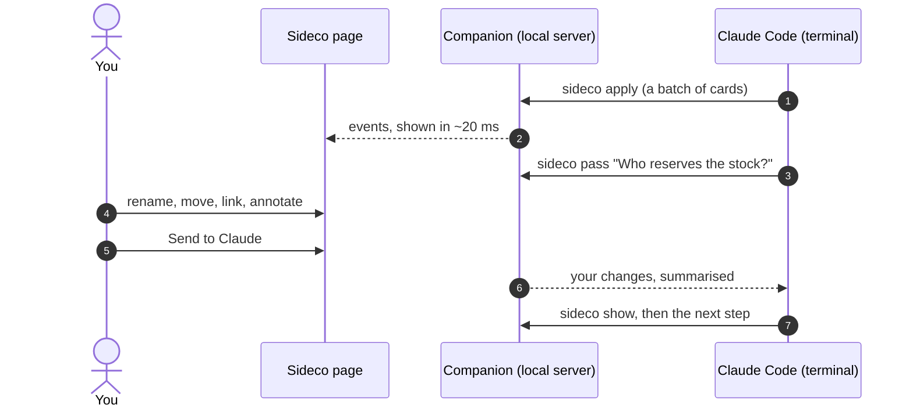

# Sideco

[](https://github.com/bastien-gallay/sideco/actions/workflows/ci.yml)

**Turn your coding agent's walls of text into a conversation you can see and reshape.**

A live, structured board beside the terminal: the agent lays out a flow, a backlog or an event storming; you answer right on the card in question; one click hands the turn back, and the agent reads what you changed. Local and MIT. Claude Code today; MCP for other agents on the roadmap.


<sub>Captured by the end-to-end test `tests/e2e/companion.test.ts`. A diamond marks a card Claude placed, a dot one you placed; the blue outline shows what just changed.</sub>

## Install

You need [Bun](https://bun.sh) 1.4 or later and Claude Code. Sideco has no other runtime dependency.

```sh
git clone https://github.com/bastien-gallay/sideco.git ~/sideco
claude plugin marketplace add ~/sideco
claude plugin install sideco@sideco
```

Then, in any project, start Claude Code and ask: *"let's model the checkout flow on the board"*. Claude creates the workspace, starts the companion and opens the page. There is nothing else to launch.

To keep the companion's address in sight, put it in Claude Code's status line: `sideco statusline` prints `sideco · 127.0.0.1:4747`, a link where the terminal supports one, and nothing outside a Sideco project. A plugin cannot set the status line, so add it to `~/.claude/settings.json` yourself:

```json
{ "statusLine": { "type": "command", "command": "~/sideco/bin/sideco statusline" } }
```

With a status line script of your own, the [guide](docs/guide.fr.md) gives the two lines to append to it.

To try it without installing, pass the plugin for one session:

```sh
claude --plugin-dir ~/sideco
```

## The loop



<sub>Source: `src/server/http.ts`, `src/cli/hook.ts`. Latency measured by `tests/e2e/companion.test.ts`.</sub>

Your changes reach Claude whatever it is doing: waiting on you, working, or idle with the page open (it is woken up). The summary is net of back-and-forth: a card added then renamed reads as one addition.

## Workshops

| Workshop | The question it asks |
| --- | --- |
| `event-storming` | What happens in the domain, in what order? |
| `flow` | Which way do we go, and where does the path split? |
| `kanban` | Where is the work, and what blocks it? |
| `story-map` | Which journey, and what do we ship first? |
| `retro` | What do we keep, stop and try? |
| `impact-effort` | What do we do first, for what it brings and what it costs? |
| `c4-context` | Who uses the system, and what does it depend on? |

Every board exports to Markdown, HTML, SVG, Mermaid or JSON, and `sideco publish` turns all of them into a static site.

## Your data stays local

- Everything is an event in an append-only log, `.sideco/boards.jsonl`, in your project. Commit it: the board's history travels with the code.
- The companion listens on `127.0.0.1` only and refuses requests from another origin.
- Undo, redo and a history slider come from the same log.

## Status

Early: version 0.1.0. One person and one active agent per workspace; two people editing the same `boards.jsonl` will get a merge conflict.

## Learn more

| Document | What is in it |
| --- | --- |
| [Detailed guide](docs/guide.fr.md) (French) | Every gesture in the page, the CLI, the Claude Code sandbox, the test suites, known limits |
| [PRD](docs/PRD.md) (French) | Why Sideco is built the way it is |
| [Contributing](CONTRIBUTING.md) | The development cycle: from a card of the backlog to a commit on `main` |
| [Coding standards](docs/coding-standards.md) | How the code is written: CUPID, a functional core, onion architecture, DDD, event sourcing |
| [To investigate](docs/to-investigate.md) | Oddities seen once and not yet understood, with what was already ruled out |
| `sideco help` | The full command list |

## License

[MIT](LICENSE)
