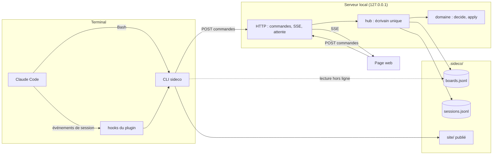
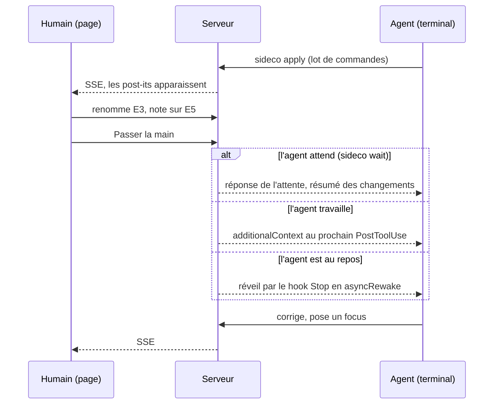

# Sideco, compagnon visuel de Claude Code : PRD

Sideco est une page web locale, ouverte à côté du terminal, où un développeur et son agent construisent ensemble un modèle visuel (event storming, flux, kanban…) pendant que l'agent travaille. Tout ce qui s'y passe est un événement dans un journal : le tableau, l'historique et les exports en sont des projections.

Rédigé le 2026-11-17. Niveau de preuve : ✅ lu sur une source primaire, ⚠️ source secondaire ou non testé, ❓ non vérifié.

## Décisions d'ensemble

| Repère | Sujet | − Écarté | + Retenu |
| --- | --- | --- | --- |
| D1 | Surface partagée | − canevas libre en x/y, façon Miro | + modèle sémantique (type, étape, colonne, lien), mise en page calculée |
| D2 | Source de vérité | − fichier d'état réécrit | + journal en ajout seul, tableau = projection |
| D3 | Agent → page | − serveur MCP dès le MVP | + CLI `sideco` et hooks Claude Code |
| D4 | Page → agent | − la page écrit dans le terminal | + contexte injecté par hook, attente bloquante, réveil |
| D5 | Ateliers | − un moteur de rendu par atelier | + un atelier = des données, sur 3 mises en page |
| D6 | Stack | − framework front, base de données | + Bun, TypeScript, zéro dépendance à l'exécution |
| D7 | Transport | − WebSocket | + SSE (descendant) et POST (montant) |
| D8 | Rendu | − un rendu page, un rendu export | + un seul peintre SVG pour les deux |
| D9 | Confidentialité | − un journal unique | + `boards.jsonl` versionnable, `sessions.jsonl` local |
| D10 | Publication | − service hébergé | + site statique généré, servi en local ou ailleurs |
| D11 | Langue | − interface en français seulement ; − langue inscrite dans le journal | + anglais par défaut, français au choix du lecteur ; l'agent lit toujours de l'anglais |
| D12 | Annulation | − pile gardée par la page, perdue au rechargement ; − réécrire ou tronquer le journal | + événements inverses ajoutés au journal, marqués du geste qu'ils annulent ; une piste par auteur, projetée comme le reste ; une annulation n'écrase jamais un changement ultérieur de l'autre auteur : aujourd'hui le geste quitte la piste sans le dire ; cible décidée le 2026-11-18 : aucune surprise, demander confirmation (B8) |
| D13 | Notes | − notes isolées : une réponse est une autre note, ou une édition de carte, sans lien avec la question | + fils de discussion : une réponse rejoint le fil de la note qu'elle suit (`thread`), à plat ; le fil porte la carte concernée ; résoudre ferme le fil entier |

## 1. Problème et public

**Cible** : développeurs et équipes techniques qui pensent visuellement, en conception technique.

**Problème** : modéliser à deux avec un agent se fait aujourd'hui en texte. Les diagrammes arrivent en fin de réponse, figés, et l'humain ne peut y répondre qu'avec des mots.

**Différence** : c'est l'interaction quotidienne du développeur avec son agent qui est représentée, pas un atelier à part.

**Complément, pas remplacement** : Sideco ne remplace pas la CLI de l'agent. La conversation reste dans le terminal ; la page est la surface de modélisation posée à côté.

| Où | Ce qui s'y fait |
| --- | --- |
| Terminal (Claude Code) | Prompts, réponses, permissions, code : inchangé |
| Page Sideco | Modifier le tableau, épingler une note, passer la main ; suivre la session en lecture seule |
| ❌ Hors périmètre | Saisir un prompt dans la page, piloter le terminal, relire tout le transcript |

| Besoin exprimé | Réponse de Sideco | MVP |
| --- | --- | --- |
| Base commune visuelle, comme en atelier | Tableau partagé, chacun pose et déplace des post-its, auteur marqué sur chacun | ✅ |
| Un problème à la fois | Un tableau = une question ; focus posé par l'agent avec sa raison | ✅ |
| Nombreux types d'ateliers | 6 ateliers livrés, définis comme des données | ✅ |
| Suivi visuel du terminal | Fil de session : état de l'agent, prompts, outils lancés, tâches | ✅ |
| Voir les modifications en direct | Hooks → journal → SSE → page, sans rechargement | ✅ à la granularité de l'outil |
| Historiser, sur plusieurs sessions | Journal persistant, curseur d'historique | ✅ |
| Éviter le coût de Miro ou FigJam | Local, open source, aucun compte | ✅ |
| Exporter en document de conception | Markdown + Mermaid, HTML, SVG, JSON | ✅ |
| Publier et servir | `sideco publish` : site statique | ✅ |

## 2. Ce que l'exploration apporte

**Reprendre** les mécanismes, pas le code : chacun des cinq projets couvre une face du besoin, aucun la boucle complète.

| Projet | Ce qu'il fait bien | Repris dans Sideco | Laissé |
| --- | --- | --- | --- |
| show-me | Choisir le visuel d'après le contenu ; repères stables `D1…Dn` ; marqueurs en tête | Identifiants courts partagés (`E1`, `C2`), signe en plus de la couleur, hook `UserPromptSubmit` | Matrice des cibles Jira, Slack |
| truepath | Processus en couches, déterministe, zéro dépendance | Mise en page de graphe portée de `layout.py` | Oracle, grille de cas, HTML figé |
| faceto | Event storming, journal JSONL, `replay` pur | Grammaire des 8 couloirs et leurs couleurs, événements au participe passé, ids préfixés attribués par le serveur, fichier `model.json` compatible | Rechargement manuel, événements sans auteur ni date |
| prismantis | Repérer les blocs à dessiner dans une réponse | Capture des `flowchart` Mermaid de la dernière réponse | Rendu terminal ; API « mod » reportée en V2 |
| impeccable live | Boucle navigateur ↔ agent | SSE + POST + attente longue côté CLI, témoin « l'agent écoute » | Injection de script dans les pages |

Sources : rapports d'exploration du 2026-11-17 sur `oss/skills/show-me`, `oss/skills/truepath`, `oss/faceto`, `NahumLitvin/prismantis@87f9ba0`, `pbakaus/impeccable@d41d986`.

## 3. Panorama

**Constat** : aucun outil trouvé ne réunit canevas local, boucle bidirectionnelle avec un agent en terminal, grammaires d'atelier et historique.

| Famille | Exemples | Ce qui manque pour ce besoin |
| --- | --- | --- |
| Tableaux blancs SaaS | Miro (8 à 20 $/membre/mois ✅), FigJam (3 à 5 $/siège ✅), Whimsical, Mural | Payant, cloud, l'agent n'y est qu'un invité par MCP |
| Canevas embarquables | tldraw (licence non OSI ✅), Excalidraw (MIT ✅) | Modèle en x/y ; pas de grammaire d'atelier |
| Diagrammes en texte | Mermaid, D2, PlantUML, Structurizr, LikeC4 | Rendu figé, l'humain ne répond pas dans le dessin |
| Canevas d'agent | Claude Artifacts, Cursor Canvases, MCP Apps | Hébergé ou lié à un hôte ; pas de `fetch` vers localhost pour les Artifacts ✅ |
| Proches | mcp_excalidraw (MIT ✅), kamiazya/whiteboard (Apache-2.0 ✅), Inkwire (⚠️ fiche d'annuaire seulement), superpowers « visual companion » ✅ | L'agent lit à la demande, rien n'est poussé ; ni ateliers, ni export de conception |
| Event storming | Qlerify (21 à 33 $/utilisateur/mois ✅), EventCatalog, Context Mapper | Payant ou documentaire, pas de boucle avec l'agent de code |

⚠️ Collision de nom : le skill brainstorming de superpowers s'appelle déjà « visual companion ». D'où « Sideco ».

Sources : miro.com/pricing, figma.com/pricing, tldraw.dev/blog/license-update-for-the-tldraw-sdk, github.com/excalidraw/excalidraw-mcp, github.com/yctimlin/mcp_excalidraw, github.com/kamiazya/whiteboard, github.com/obra/superpowers, qlerify.com/pricing, code.claude.com/docs/en/artifacts.md, consultées le 2026-11-17.

## 4. Tes idées, challengées

| Repère | Ton idée | Objection | Proposition |
| --- | --- | --- | --- |
| C1 | Un Miro moins cher | Le coût n'est pas le vrai manque : un canevas en pixels est illisible pour un agent | Se positionner sur le modèle partagé, pas sur le prix (D1) |
| C2 | De nombreux ateliers | La largeur tue la qualité | 3 mises en page solides, les ateliers par-dessus en données (D5) |
| C3 | Suivre le terminal visuellement | Refaire un lecteur de transcript existe déjà (claude-code-viewer) | Montrer l'état et les étapes, et les relier à l'histoire du tableau |
| C4 | Voir pendant que l'agent réfléchit | Les hooks ne voient pas le texte en cours de génération | MVP à la granularité de l'outil ; flux de texte en V2 par l'API mod |
| C5 | Détecter les visuels dans les réponses | Détection heuristique, donc avec pertes | L'agent écrit d'abord sur le tableau ; la capture reste un filet |
| C6 | Interaction riche dans les deux sens | La page ne peut pas taper dans le terminal | Trois canaux de retour, limites dites (voir 6.3) |
| C7 | Historiser les sessions | Un journal de session contient prompts et commandes | Deux fichiers : le dessin se versionne, la trace reste locale (D9) |
| C8 | Publier et servir | Un service à héberger coûte et s'éteint | Fichiers statiques (D10) |
| C9 | Multi-utilisateurs plus tard | Un écrivain unique et un `seq` global ne fusionnent pas dans git | ⚠️ non résolu au MVP, à traiter avant toute promesse d'équipe |
| C10 | Le tableau nourrit l'agent | Tout texte du tableau entre dans son contexte : vecteur d'injection | Écoute en boucle locale seule, origine vérifiée, contenu présenté comme une saisie de l'utilisateur |

Pourquoi D1 pèse le plus : pour un diagramme de séquence simple, Mermaid coûte environ 50 tokens, un JSON Excalidraw environ 500, un XML draw.io environ 1 200 (⚠️ estimations d'auteur, dev.to/akari_iku, octobre 2025). Un modèle sémantique reste lisible à chaque tour ; un canevas en pixels, non.

### Enrichissements

| Repère | Ajout | Pourquoi |
| --- | --- | --- |
| E1 | Passer la main, dans les deux sens | En atelier on se passe le feutre ; ici c'est un événement, et il réveille l'autre |
| E2 | Identifiants courts et stables sur chaque post-it | « Découpe E3 » se dit pareil au clavier et à l'écran |
| E3 | Auteur visible sur chaque post-it (losange agent, point humain) | La modélisation croisée se lit d'un coup d'œil, sans dépendre d'une couleur |
| E4 | Curseur « vu par Claude » | L'humain sait lesquelles de ses modifications l'agent a déjà reçues |
| E5 | Focus avec raison | Un problème à la fois, désigné par celui qui parle |
| E6 | Notes épinglées, adressées à l'autre | Répondre dans le dessin plutôt qu'à côté |
| E7 | Exports qui déclarent leurs pertes | Un Mermaid ne dit pas tout ce que dit un tableau |
| E8 | Remonter le temps, tableau et session ensemble | « Qu'y avait-il à l'écran quand il a lancé cette commande ? » |

## 5. Exigences

### 5.1 Parcours de référence

1. Le développeur lance `sideco open` : la page s'ouvre, vide, et propose six ateliers.
2. Il demande à Claude un event storming du passage de commande.
3. Claude crée le tableau en un lot ; les post-its apparaissent pendant qu'il continue à lire le code.
4. Le développeur renomme un événement, en déplace un autre, épingle une note, puis clique « Hand over to Claude ».
5. Claude reçoit le résumé net de ces changements, corrige le modèle, pose le focus sur un point chaud.
6. Le développeur exporte le tableau en Markdown dans `docs/` et publie le site statique.

### 5.2 Exigences fonctionnelles

| Repère | Exigence | MVP |
| --- | --- | --- |
| F1 | Créer un tableau dans un atelier donné, depuis la page ou la CLI | ✅ |
| F2 | Ajouter, renommer, détailler, déplacer, relier, supprimer un élément, des deux côtés | ✅ |
| F3 | Mise en page calculée ; aucun x/y stocké | ✅ |
| F4 | Lot atomique : tout ou rien | ✅ |
| F5 | Lire un tableau en texte compact (`sideco show`) | ✅ |
| F6 | Résumé net des changements humains depuis la dernière lecture de l'agent | ✅ |
| F7 | Passer la main ; attente bloquante côté agent | ✅ |
| F8 | Notes adressées, à résoudre | ✅ |
| F9 | Focus posé par l'un, visible par l'autre | ✅ |
| F10 | Fil de session en direct | ✅ |
| F11 | Capture des `flowchart` Mermaid des réponses en tableaux éditables | ✅ |
| F12 | Historique rejouable | ✅ |
| F13 | Exports Markdown, HTML, SVG, Mermaid, JSON ; import JSON | ✅ |
| F14 | Publication en site statique | ✅ |
| F15 | Ateliers définis par la communauté dans des fichiers | ❌ plus tard |
| F16 | Plusieurs humains ou plusieurs agents sur un même tableau | ❌ plus tard |
| F17 | Page, dessin et exports en anglais par défaut, en français au choix du lecteur (sélecteur de la page, `--lang`, `SIDECO_LANG`) ; le texte lu par l'agent reste en anglais | ✅ |
| F18 | Annuler et rétablir ses propres gestes dans la page (`Undo`, `Redo`, raccourcis), tableau supprimé compris ; l'agent n'est informé que du résultat net | ✅ |
| F19 | Discuter par notes : répondre dans le fil d'une note, depuis la page ou par `sideco reply` ; chaque fil nomme sa carte, la carte montre ses fils, et le fil dit qui est attendu | ✅ |
| F20 | Ajouter là où l'on pointe : un « + » apparaît au survol d'une case ou d'une colonne, un par type possible, et la carte se pose à cet endroit (S1 du story map du 2026-11-18) | ✅ |
| F21 | Cartes à la hauteur de leur libellé, de 48 à 88 px ; piles, rangées et zones de dépôt suivent (S22) | ✅ |
| F22 | Une commande qui ne change rien (même libellé, même détail, même titre) n'enregistre rien ; rouvrir une carte dans la page sans la modifier n'envoie rien (S5) | ✅ |
| F23 | Claude au repos reste joignable depuis la page une journée de travail (12 h après son dernier tour) ; la fermeture de la session libère l'écoute, et la page dit alors qu'aucune session n'est reliée | ✅ testé ; ⚠️ pas encore essayé en session réelle au-delà de quelques minutes |
| F24 | Marquer ce que Claude n'a pas encore lu : une pastille sur chaque carte et un mot sous chaque fil que nomme le résumé en attente, jusqu'à sa remise à la session ; jamais dans l'historique (S4) | ✅ |
| F25 | Atelier Impact / Effort : la matrice 2 × 2 dépliée en quatre colonnes (gains rapides, gros paris, remplissage, à éviter), chacune disant sous son nom l'impact et l'effort qu'elle représente (T29, S24) | ✅ |
| F26 | Insérer une colonne depuis la page : dans une frise, un « + » apparaît au survol de la frontière entre deux étapes, et les étapes suivantes se décalent ; un Undo la retire (T41, S32) | ✅ ; ⚠️ souris seulement |
| F27 | Marquer une carte comme faite (sauf sur un kanban, voir F36), depuis la page (barre de la carte, touche `d`) ou par Claude (`sideco done`, `sideco undone`) : coche et libellé barré, annulable, dit à l'agent, gardé par l'export en modèle (T27, S37) | ✅ ; ⚠️ les exports Markdown, Mermaid et HTML ne le montrent pas |
| F28 | Impact / Effort en vrai plan 2 × 2 : les quatre couloirs deviennent quatre cases (impact fort en haut, effort faible à gauche), deux cartes de front par case, les deux axes nommés à côté ; les données ne changent pas (T47, S44) | ✅ ; ⚠️ pas de placement fin dans une case, et la grille n'est pas encore offerte aux autres ateliers |
| F29 | Une colonne de kanban, de rétro ou d'Impact / Effort se renomme pour un tableau : `sideco lane LANE "Nom"`. Le nom vaut pour ce tableau, dans toutes les langues et tous les exports ; il s'annule. Dans la page : double-clic sur le nom de la colonne | Livré |
| F30 | Une colonne d'une frise se déplace d'un bloc, ses cartes avec elle : `sideco move-col DE VERS`. Les colonnes traversées se resserrent ; un seul Undo la remet. Dans la page : glisser le numéro de l'étape (T65) | ✅ ; ⚠️ souris seulement |
| F31 | Plusieurs sessions dans un même projet : chacune ne reçoit que les changements et les passages de main des tableaux qu'elle suit. Elle suit un tableau en y écrivant, en le lisant (`sideco show`) ou en le disant (`sideco follow`) ; `sideco unfollow` le lâche. Un tableau qu'aucune session en cours ne suit est remis à toutes | Livré ; le passage de main vise une session, par défaut la dernière à avoir écrit sur le tableau, nommée sous le bouton ; seule elle est réveillée (2026-11-19) |
| F32 | Quand Claude a passé la main, l'en-tête le dit par une pastille, quel que soit le tableau à l'écran, et le titre de l'onglet commence par « ● Claude t'attend ». Si une session écoute la réponse (`sideco wait`), la pastille et l'onglet disent « Claude est bloqué sur toi », dans la couleur de ce qui arrête le travail | Livré ; une notification du navigateur reste à étudier (S107) |
| F33 | L'agent lit une partie d'un tableau : `sideco show BOARD --lane L`, `--col N`, `--brief` (sans les détails), `--notes` (les fils ouverts seuls), et `sideco show ID` pour une carte avec sa place, ses liens et ses fils. La première ligne nomme la partie lue, pour qu'elle ne passe pas pour le tout | Livré |
| F34 | L'éditeur d'une carte reste ouvert, avec son texte et le curseur, quand Claude écrit sur le tableau pendant la saisie ; ce que l'humain valide l'emporte. Si la carte est supprimée entre-temps, l'éditeur se ferme et le texte saisi est rendu dans un message | Livré |
| F35 | Un kanban et une rétro ont leurs propres colonnes : `sideco lane add "Nom" [--before L]`, `sideco lane rm L` (vide seulement, jamais la dernière), `sideco lane move L [--before L]`. Dans la page : un « + » au survol de l'espace entre deux en-têtes, un « × » dans l'en-tête d'une colonne vide, l'en-tête se glisse pour déplacer la colonne avec ses cartes. Au clavier, l'en-tête d'une colonne est un arrêt de Tab : Entrée renomme, Maj + ← → déplace, Suppr supprime si vide, + ou Alt + ← → ajoute une colonne. Tout s'annule, se dit à l'agent et se garde à l'export (T57, T65, T81) | ✅ |
| F36 | Sur un kanban, « fait » est la dernière colonne : `done` et la touche `d` y envoient la carte, `undone` la remet dans la colonne d'avant ; ni coche ni libellé barré, la colonne le dit (T79) | ✅ |
| F37 | Supprimer une étape vide d'une frise depuis la page : un « × » en haut de l'étape vide, Annuler dans l'avis ; la réserve de droite ne se supprime pas (T48) | ✅ ; ⚠️ souris seulement |
| F38 | Une rétro part de « Went well » et « Didn't go well », puis Keep / Stop / Try ; un constat a l'id P (les anciens K restent acceptés), une action sans colonne va dans Try, et « En faire une action » dans la barre d'un constat ajoute une action dans Try, reliée à lui (T26, T74) | ✅ ; ⚠️ pas de touche dédiée |
| F39 | Impact / Effort se lit comme une matrice : chaque axe nomme ses deux bouts, « faible » et « fort », et le nom d'une case suit aussi le défilement de côté, sans quitter sa case (T73) | ✅ |
| F40 | Une story map garde son épine dorsale en vue : une fois les activités passées sous les numéros d'étape, chaque étape dit là son activité (qui court jusqu'à la suivante) et sa tâche (T78) | ✅ |
| F41 | Sur une frise (event storming, story map), le nom qu'un lecteur d'écran entend dit l'étape, la rangée et, dans une case de plusieurs cartes, le rang : « étape 2, rangée Règle », « étape 1, rangée Événement, 2 sur 3 » (T80) | ✅ ; ⚠️ pas encore essayé avec VoiceOver (T72) |
| F42 | Dans un flux, un humain nomme une branche depuis la page (barre du lien, ou double-clic sur le lien) ; le nom d'une branche se pose à côté de sa propre flèche, jamais sur le rail d'une autre (T75) | ✅ ; ⚠️ pas de chemin au clavier jusqu'à un lien |
| F43 | Un flux trop long pour une colonne se replie, dans une fenêtre assez large, en colonnes côte à côte qui se lisent comme un journal : on descend la première, la flèche monte par l'allée et reprend en haut de la suivante. Une coupe ne tombe qu'où une seule flèche passe et qu'aucune boucle ne remonte ; l'export garde une colonne (T76) | ✅ |
| F44 | La barre du haut se lit en trois groupes : le tableau (son nom et un menu `⋯` qui reçoit nouveau tableau, export et suppression), ce que fait Claude au centre, la vue à droite (annuler, zoom, langue) (T87) | ✅ |
| F45 | Les panneaux latéraux se replient en rail de 40 px, par leur bouton ou les touches `[` et `]` ; le rail de gauche garde les types pour ajouter d'un clic. Le choix est gardé par le navigateur, et une fenêtre de moins de 1 100 px replie les deux (T84) | ✅ |
| F46 | Le panneau de droite a deux onglets, Session et Détail : choisir une carte ouvre Détail, grisé tant qu'aucune carte n'est choisie ; les flèches vont d'onglet en onglet, et le rail replié garde un onglet par icône (T85) | ✅ |
| F47 | L'historique devient un onglet du panneau de droite : la liste des événements, du plus récent au plus ancien, chacun cliquable pour revoir le tableau tel qu'il était ; ↑ ↓ au clavier, ◄ ► en tête, « This board / Everything ». Le curseur du pied de page disparaît : le pied ne garde que le passage de main (T86) | ✅ |
| F48 | Claude annule et rétablit ses propres gestes : `sideco undo`, `sideco redo`, chacun nommé dans les mots du CLI (`rename E1 "Payée"`) ; `--dry-run` le montre sans écrire. Un geste que l'autre auteur a modifié depuis est refusé, avec la raison (qui, quel numéro) et ce que prendra l'annulation suivante ; le refus est un événement `UndoRefused` du journal, et le geste quitte la piste. Même règle pour l'Undo de la page (B8, T15) | ✅ |
| F49 | De retour sur un tableau, la page dit ce que Claude y a changé depuis ta dernière visite dans ce navigateur : un bandeau compte les changements (« Next changed card » mène de l'une à l'autre, « See them in History », « Got it »), les cartes touchées portent un triangle d'accent dans leur coin bas, l'historique marque ces moments. Ce qui arrive pendant que tu regardes n'est pas compté (T8) | ✅ |
| F50 | Un tableau dit ses propres sous-titres de colonne et, sur un plan, ses propres axes : `sideco lane hint LANE "Ce qu'elle représente"`, `sideco axis x (ou y) "Nom" [Bas] [Haut]`. Un texte vide rend ceux de l'atelier. Ils valent dans toutes les langues, se disent à l'agent (`show`, changements), s'annulent et se gardent à l'export. Ainsi un SWOT posé sur un Impact / Effort ne garde plus « High impact · low effort » sous « Strength » (T117, D1 de T104) | ✅ |

### 5.3 Exigences de qualité

| Repère | Exigence | Mesure |
| --- | --- | --- |
| Q1 | Boucle rapide | Une commande de l'agent est à l'écran en moins de 200 ms ; un hook rend la main en moins de 100 ms hors démarrage |
| Q2 | Affordance | Un nouvel utilisateur crée un tableau et pose un post-it sans aide ; la palette sert aussi de légende |
| Q3 | Innocuité | Un hook n'empêche jamais l'agent d'avancer : sans serveur ou en cas d'erreur, il se tait |
| Q4 | Prévisibilité | Même journal, même tableau, même dessin, à l'octet près |
| Q5 | Sobriété | Zéro dépendance à l'exécution ; la page tient en une requête et fonctionne hors ligne |
| Q6 | Sécurité locale | Écoute sur 127.0.0.1 ; requêtes d'une autre origine refusées |
| Q7 | Accessibilité | Tout geste a un équivalent clavier ; aucune information portée par la couleur seule |

## 6. Architecture

### 6.1 Composants

Le même code de domaine tourne dans le serveur, la CLI et la page : les trois replient le journal avec la même fonction.

| Couche | Rôle | Dépend de |
| --- | --- | --- |
| `src/domain` | Événements, commandes, décision, projection, mises en page, exports, capture. Pur : ni E/S ni horloge | rien |
| `src/server` | Journal sur disque, hub, HTTP | domaine |
| `src/cli` | Commandes `sideco`, point d'entrée des hooks | domaine, serveur (démarrage) |
| `src/web` | Page : peinture SVG, gestes, fil de session | domaine |

### 6.2 Modèle d'événements

Chaque ligne du journal porte `seq`, `ts`, `actor` (`human`, `agent`, `system`) et, si connue, `session`.

| Flux | Événements |
| --- | --- |
| Tableau | `BoardCreated`, `BoardRetitled`, `LaneNamed`, `ElementAdded`, `ElementRenamed`, `ElementAnnotated`, `ElementMoved`, `ElementRemoved`, `ColumnInserted`, `ColumnMoved`, `EdgeAdded`, `EdgeRemoved`, `FocusSet`, `FocusCleared`, `NoteAdded`, `NoteResolved`, `TurnPassed` |
| Session | `SessionStarted`, `BoardsFollowed`, `BoardsLeft`, `PromptSubmitted`, `ToolStarted`, `ToolFinished`, `TodosUpdated`, `AgentNotified`, `TurnEnded`, `ChangesDelivered` |

Une réponse est un `NoteAdded` qui porte `thread`, l'identifiant de la note qui a ouvert le fil ; sans ce champ, la note ouvre un fil. `NoteResolved` ferme le fil entier.

Évolution du schéma par ajout seulement : un lecteur ignore ce qu'il ne connaît pas, et un renommage passe par un point unique (`upcast`). Les commandes, elles, forment un ensemble fermé, validé à la frontière.

### 6.3 La boucle, dans les deux sens

| Canal de retour | Quand | Mécanisme Claude Code | Preuve |
| --- | --- | --- | --- |
| Au prochain message | Toujours | `UserPromptSubmit` → `additionalContext` | ✅ documenté |
| En cours de tour | Après « Passer la main » | `PostToolUse` → `additionalContext` | ✅ documenté |
| Attente explicite | L'agent lance `sideco wait` | Commande bloquante, attente longue HTTP | ✅ ne dépend pas de Claude Code |
| Au repos | Après « Passer la main » | Hook `Stop` avec `asyncRewake`, code de sortie 2 | ⚠️ documenté, mais les événements autorisés ne sont pas listés : à tester en session réelle |

Source : code.claude.com/docs/en/hooks, lue le 2026-11-17 (limite de 10 000 caractères par `additionalContext` ✅).

### 6.4 Ateliers et mises en page

| Mise en page | Position sémantique | Ateliers livrés |
| --- | --- | --- |
| Chronologie | type (ligne) × étape (colonne, à partir de 1) | Event Storming, Story Mapping |
| Colonnes | colonne nommée + rang | Kanban, Rétrospective, Impact / Effort |
| Graphe | aucune : déduite des liens | Flux |

Un atelier déclare ses types (libellé, préfixe d'identifiant, couleur, forme), sa mise en page et ses colonnes. L'ajouter ne demande aucun code de rendu.

## 7. Stack technique

| Sujet | + Choix | − Écarté | Raison |
| --- | --- | --- | --- |
| Langage | TypeScript strict | Rust, Python | Un seul code de domaine pour serveur, CLI et page |
| Exécution | Bun | Node + bundler | Serveur HTTP, bundler, tests et TypeScript intégrés |
| Dépendances | Aucune à l'exécution | Framework front, ORM | Démarrage rapide, surface d'attaque nulle, confiance |
| Page | DOM et SVG natifs | React, tldraw, Excalidraw | Modèle sémantique, pas de canevas x/y ; licence tldraw |
| Persistance | JSONL en ajout seul | SQLite | Lisible, diffable, versionnable |
| Transport | SSE + POST | WebSocket | Reprise native par `Last-Event-ID` ; même POST pour la page et la CLI |
| Intégration | Plugin Claude Code : hooks + skill | MCP, channels | Hooks stables ; channels en préversion ✅ |
| Qualité | Biome, `tsc`, `bun test`, Playwright, markdownlint | | |

## 8. Périmètre MVP et backlog

| Horizon | Contenu |
| --- | --- |
| **MVP** | F1 à F14 ; 5 ateliers ; plugin (hooks + skill) ; tests unitaires, d'intégration et de bout en bout |
| Ensuite | Serveur MCP typé ; flux de texte en direct par l'API mod ; ateliers en fichiers (F15) ; capture des diagrammes de séquence et des tables ; annuler/rétablir ; binaire unique ; diff « depuis ma dernière visite » |
| Plus tard | Multi-utilisateurs et multi-agents (F16) ; compaction du journal ; C4, Wardley, impact mapping ; hébergement partagé |

Hors MVP, assumé : dessin libre, images, curseurs multiples, comptes, synchronisation distante.

**Traiter** « Ensuite » et « Manques connus » avant toute nouvelle idée : priorité donnée le 2026-11-18. Ordre arrêté le même jour, du prochain au dernier : L1, L6, B5, L2, B7, L3, B3, B1, B4, B2, L4, B6. B8 et B9, ajoutés le 2026-11-18, sont en fin de liste, pas encore ordonnés. Le kanban « backlog » de Sideco porte l'ordre courant ; il n'est pas versionné pour l'instant.

| Repère | Ensuite |
| --- | --- |
| B1 | Serveur MCP typé |
| B2 | Flux de texte en direct par l'API mod |
| B3 | Ateliers en fichiers (F15) |
| B4 | Capture des diagrammes de séquence et des tables |
| B5 | ✅ Annuler / rétablir, livré le 2026-11-18 (F18, D12). Notes, passage de main et insertion de colonne restent non annulables : ni urgent ni important (décision du 2026-11-18) |
| B6 | Binaire unique |
| B7 | Diff « depuis ma dernière visite » |
| B8 | Annulation sans surprise : quand le geste à annuler a été modifié ailleurs que sur la page ouverte, la page demande confirmation au lieu de passer au geste précédent |
| B9 | ✅ `sideco undo` et `sideco redo` pour Claude, livrés le 2026-11-20 (F48) sur le modèle de `git revert` : geste nommé, `--dry-run` le montre avant d'écrire, refus en cas de conflit, jamais un geste de l'humain |

| Repère | Manque connu | Conséquence aujourd'hui |
| --- | --- | --- |
| L1 | ✅ Levé le 2026-11-18 : bouton `Remove` à côté du choix du tableau, avec confirmation | ✅ Rien : `Undo` restaure le tableau supprimé (B5) |
| L2 | Seule la session la plus récente est affichée | Deux sessions Claude Code dans le même projet : une seule est suivie |
| L3 | ✅ Levé le 2026-11-19 : le compagnon s'arrête seul 5 min après la dernière page ouverte, la dernière session en attente et la dernière session ouverte ; une session muette depuis 12 h ne compte plus | ✅ Rien ; `SIDECO_IDLE_MS` règle le délai, `off` le désactive |
| L4 | Deux branches qui écrivent dans `boards.jsonl` | ⚠️ Conflit de fusion probable, non essayé ; vérification : fusionner deux branches qui ont chacune ajouté des événements |
| L6 | Premier `sideco open` d'un projet sous bac à sable | ✅ Observé le 2026-11-18 avec `allowLocalBinding` : espace de travail créé, compagnon démarré, écritures acceptées ; seule l'ouverture de la page échoue, avec la consigne de relancer hors bac à sable. ⚠️ Bac à sable par défaut (sans `allowLocalBinding`) : toujours non observé, refus attendu avec `this shell may not start the companion` (test unitaire seulement) ; vérification : retirer le réglage le temps d'un essai |

Source : backlog présenté en session le 2026-11-18 ; L1 à L3 : `src/web/main.ts`, `src/domain/workspace.ts` (`latestSession`), `src/cli/main.ts` (`stop`), `src/server/idle.ts` ; L5 n'est pas une tâche mais un risque : voir R2.

## 9. Risques

| Repère | Risque | Parade |
| --- | --- | --- |
| R1 | ✅ `asyncRewake` sur `Stop` réveille bien une session interactive au repos (essai réel du 2026-11-17, Claude Code 2.1.326). Revers constaté : un hook en attente empêche `claude -p` de se terminer | Le hook n'attend que si une page est ouverte, et jamais dans une session sans interface |
| R1b | Le client HTTP de Bun abandonne une requête restée muette (`TimeoutError` à 360 s, mesuré le 2026-11-18 avec Bun 1.4.4) : `sideco wait` au-delà de 6 min plantait, et le hook de réveil s'éteignait sans rien dire après 6 min de repos | L'écoute se fait par requêtes de 4 min enchaînées (`listen`) ; ⚠️ réveil après plus de 6 min de repos à réessayer en session réelle |
| R1c | Essai du 2026-11-18 : un passage de main 4 h 10 après le dernier tour n'a réveillé personne, l'écoute ne durait que 25 min. La doc de Claude Code ne donne pas de plafond au `timeout` d'un hook, et ne dit pas ce que devient un hook parqué à la fermeture d'une session interactive ni à la compaction | Écoute de 12 h (`REWAKE_WAIT_MS`, `timeout` du hook à 43 500 s) ; hook `SessionEnd` qui libère l'écoute (20 ms mesurés, pour 1,5 s accordée à un plugin) ; ⚠️ à observer en session réelle : tenue sur plusieurs heures, et effet d'une compaction |
| R2 | ⚠️ Le schéma de `TodoWrite` n'est pas documenté dans la page des hooks : le panneau de tâches peut se vider sans prévenir à une mise à jour de Claude Code (`src/cli/hook.ts`) | Lecture défensive ; `TaskCreated` et `TaskCompleted`, documentés, en second |
| R3 | Le contenu du tableau sert de vecteur d'injection | Boucle locale, origine vérifiée, cadrage du texte injecté |
| R4 | Le journal grossit (une ligne par outil lancé) | Résumés courts, sorties d'outil jamais stockées ; compaction plus tard |
| R5 | `boards.jsonl` en conflit de fusion entre deux développeurs | Non traité au MVP ; à résoudre avant F16 |
| R6 | L'agent n'utilise pas le tableau spontanément | Skill dédié ; rappel au démarrage de session par le hook |
| R7 | Le bac à sable de Bash bloque les connexions locales : les écritures `sideco` de l'agent échouent (constaté le 2026-11-17) | Message d'erreur explicite, consigne dans le skill ; ✅ `sandbox.network.allowLocalBinding` essayé le 2026-11-18 (démarrage, écriture, arrêt depuis le bac à sable) ; le compagnon ouvre lui-même la page quand le shell ne le peut pas (`POST /api/open`) ; ⚠️ `excludedCommands` non essayé |

## 10. Mesures de succès

- Une commande de l'agent est visible dans la page sans rechargement, en moins de 200 ms.
- Une modification humaine arrive dans le contexte de l'agent sans copier-coller.
- Un tableau exporté s'affiche tel quel dans un dépôt GitHub ou GitLab.
- Un event storming de faceto s'importe et se réexporte sans perte de ses éléments ni de ses liens.
