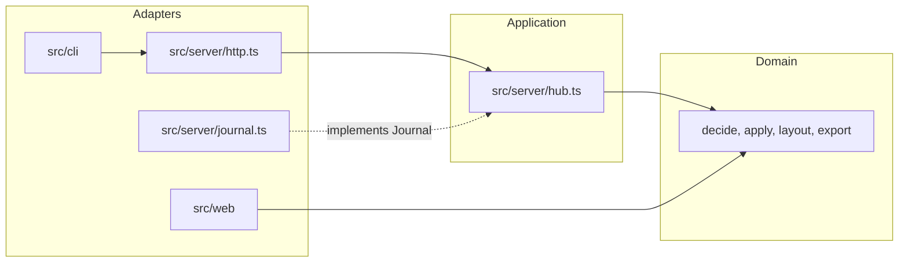

# Coding standards

How sideco's code is written. The development cycle that produces it is in
[CONTRIBUTING.md](../CONTRIBUTING.md).

In one line: **a functional core shaped by its domain, an imperative shell of
small objects around it, and the discipline of object calisthenics applied to
both.**

| Part | Rule of thumb |
| --- | --- |
| [CUPID](#cupid) | The properties every change is read against |
| [Paradigm](#paradigm-functional-core-calisthenics-discipline) | Data as types, behaviour as functions, state in a few shell objects |
| [Architecture](#architecture-onion) | Dependencies point inward, to a domain that does no I/O |
| [Domain](#domain-driven-design) | The code speaks the words of the workshops |
| [Event sourcing](#event-sourcing) | Facts are appended once, never rewritten |
| [TypeScript](#typescript) | The compiler proves what it can |
| [Known gaps](#known-gaps) | Where the code is not there yet |

## CUPID

Properties, not rules: a change makes the code more or less of each.

| Property | In sideco |
| --- | --- |
| **Composable** | Small functions with few inputs and no hidden state, so they can be used elsewhere: `apply` folds the journal on the server and on the page; `layoutBoard` draws for the page and for the HTML export; `decide` serves the hub, the CLI and the tests. |
| **Unix philosophy** | One module, one job, said in its header comment. `decide.ts` decides; it never records, draws or sends. |
| **Predictable** | Same input, same output. The domain reads no randomness and no file, and takes time and ids as arguments. Tests are fast and never flaky because of it. |
| **Idiomatic** | Plain TypeScript as its community writes it, run by Bun. No framework, no library that re-implements the language (no fp-ts, no Effect, no classes for data). |
| **Domain-based** | Names come from the workshops, not from the technique: `Board`, `Lane`, `Gesture`, `Turn`, not `Entity`, `Manager`, `Helper`, `Util`. |

## Paradigm: functional core, calisthenics discipline

Two schools pull on a TypeScript codebase:

- **A. Functional first.** Make impossible states impossible, compose
  fallible steps on a railway of `Result`s.
- **B. Object-oriented.** Well-structured objects, kept small by object
  calisthenics.

sideco takes the model from A and the discipline from B. Each concern goes to
the school that serves it best:

| Concern | Choice | Why |
| --- | --- | --- |
| Data | **A**: types (interfaces, discriminated unions), never classes | Events are serialised, replayed and sent to the page: plain data crosses every boundary unchanged. |
| Behaviour on data | **A**: functions, grouped by module | A module is the unit of cohesion; a function that takes the board is as encapsulated as a method on it, and composes better. |
| Expected failure | **A**: a value (`Decision.refused`, `Result`), with one exception inside `decide` | A refused command is a normal outcome the caller must handle; the type says so. |
| Bug | `throw` | An invariant broken is not a path to compose, it is a stop. |
| State with a lifecycle | **B**: a small class in the shell | The hub, the relay and the idle watch own mutable state, listeners and timers: an object hides them behind a few verbs. |
| Size and shape | **B**: object calisthenics, adapted | Short functions, flat control flow and named concepts read the same in either paradigm. |

### Make impossible states impossible

- A value that has kinds is a **discriminated union** on `type` or `kind`,
  never a bag of optional fields: an `ElementAdded` cannot lack its element.
- A `switch` on a union handles every kind, so that a new kind breaks the
  build where it is not handled. When each case returns a value, the
  function's return type already checks it; when the cases do things, the
  switch ends with `default: handledAll(value)`
  ([src/domain/handled-all.ts](../src/domain/handled-all.ts)).
- **Parse, don't validate**: input from outside (argv, HTTP, the journal) is
  turned into domain types once, at the edge. Inside, no function re-checks
  what the type already says.
- An identifier that has rules (board id, element id) is a **branded type**
  made by the function that checks those rules. A plain `string` is accepted
  only where any string is.
- `readonly` on what a function receives. Optional fields only when absence
  means something, and that meaning is said in a comment.

### The railway, kept short

A chain of fallible steps returns a `Result` rather than throwing:

```ts
type Result<T, E = string> = { ok: true; value: T } | { ok: false; error: E };
```

- Use it where **three or more fallible steps** follow one another (parse,
  then resolve, then decide). For one step, an early `return` is clearer.
- The helpers (`ok`, `fail`, `andThen`, `map`) will live in one small module
  of the domain, written with the first code that needs them. No library.
- The error side is domain language: a reason the user can read, not an
  exception class.
- At the shell, the `Result` becomes an HTTP status, an exit code or a message
  on the page. It is never turned back into an exception.

**The exception: `decide` throws its refusals.** Inside `decide`, a rule that
refuses a command throws a `CommandError`. `atCommand` (`src/server/hub.ts`)
tags it with the index of its command in the batch, and the adapter turns it
into the refusal: an HTTP 400 in `src/server/http.ts`, a message in the CLI.
That is a railway with one exit per adapter: no refusal can be forgotten, and the rules read as a list of guards. It stays as it is. New
code at the edges, where a failure has several callers (argv, HTTP), returns
a `Result`.

### Object calisthenics, adapted

Jeff Bay's nine rules, read for a functional core:

| Rule | In sideco |
| --- | --- |
| One level of indentation per function | A guide, not a gate. Early returns and small named functions instead of nesting; a loop over geometry may nest once more rather than be cut into pieces with no name in the domain. |
| No `else` | Kept: return early. A `switch` on a union replaces an `if` chain. |
| Wrap primitives | Kept, as branded types and named unions (`Actor`, `AgentStatus`), not as wrapper classes. |
| First-class collections | Kept: a collection with rules gets its type and its functions (`lanesOf`, `threads`). |
| One dot per line | Read as *don't reach through*: a function takes what it needs, not the workspace to dig into. |
| Don't abbreviate | Kept. `element`, not `el`, outside a one-line lambda. |
| Keep entities small | **A module stays under 400 lines** and does one job: a firm limit, since a reader who sees a large file in pieces misses the function that already does what they add. A function fits on a screen (about 40 lines), with a cognitive complexity of 15 at most: a guide. Biome checks both: the module limit is an error, the function ones are infos. |
| Two instance variables at most | Replaced: three parameters at most, beyond that one named object. |
| No getters or setters | For shell objects: *tell, don't ask*, they expose verbs, not their state. For data: not applicable, data is read directly. |

## Architecture: onion



| Layer | Holds | May import | Never |
| --- | --- | --- | --- |
| **Domain** `src/domain` | Events, commands, `decide`, the `apply` projection, layout, render, export | Only the domain | `node:`, `bun:`, the DOM, the clock, randomness, I/O |
| **Application** `src/server/hub.ts` | The use case: load, decide, append, notify, all or nothing | Domain, ports | A file path, HTTP, a socket |
| **Adapters** `src/server`, `src/cli`, `src/web` | HTTP, the journal file, the CLI, the page | Application, domain | Each other's insides |

- **Ports are declared by who needs them**, as an interface or a function
  type. The hub takes a `Journal` and a `now: () => Date`; the file adapter
  and the in-memory one used by tests implement `Journal`.
- **The page is an adapter with its own projection.** It imports the pure
  domain to fold the same events (`apply`), never the server.
- **A new dependency points inward or it does not go in.** The rule is data
  in [tests/layers.ts](../tests/layers.ts), and a unit test holds every module
  of `src/` to it.

## Domain-driven design

### Ubiquitous language

The code uses the words of the page and of the workshops, and only them.

| Word | Meaning |
| --- | --- |
| Board | One workshop's surface: a kanban, a flow, a story map… |
| Format | The workshop a board follows; it sets the element types and the layout. |
| Element | A card on a board; its type comes from the format. |
| Lane, column, step | Where an element sits, by format. |
| Edge | A link between two elements. |
| Note, thread | A remark on a board or an element, and its replies. |
| Gesture | What one command did; undo takes back a whole gesture. |
| Session | An agent's conversation, known to the companion. |
| Turn | A hand-over of the board between the user and an agent. |
| Actor | Who did it: `human`, `agent` or `system`. |

A new concept gets its word here before it gets a type in the code.

### Aggregates and contexts

- **Board** and **Session** are the aggregates: a command touches one, and
  `decide` checks every rule of that one before any event is emitted.
- **Modelling** (boards, elements, notes, undo) is the core domain. **Agent
  presence** (sessions, turns, tools) is the second. **Layout**, **render**
  and **export** are supporting: pure functions from a board to a scene, an
  SVG or a text, which never decide anything.

## Event sourcing

- **Commands are verbs, events are facts**: `add`, `move` become
  `ElementAdded`, `ElementMoved`, in the past tense.
- **`decide` decides, `apply` folds.** `decide(workspace, command, context)`
  returns events or a refusal and changes nothing; `apply(workspace, event)`
  is the only place a projection changes.
- **Appended once, never rewritten.** The journal is the truth; boards and
  sessions are projections of it, rebuilt at boot.
- **Schema evolution is additive.** A reader ignores what it does not know.
  `upcast` in `journal.ts` is the single point where an old line becomes a
  current event: today it drops what it does not know, and a renamed event
  will be migrated there.
- **Undo is recorded as ordinary events**, each carrying in `undoes` the seq
  of the gesture it takes back.
- **Mutation stays local.** For speed, `apply` folds into the workspace it is
  given; only the owner of a projection calls it: the hub, the page
  store, or a function on a copy of its own, as `digest.ts` does. Nothing
  else holds that object.

## TypeScript

- `strict`, `noUncheckedIndexedAccess`, `noImplicitOverride`,
  `noFallthroughCasesInSwitch`: see [tsconfig.json](../tsconfig.json).
- Biome's recommended rules, plus no `any` and no non-null assertion `!`: a
  value that may be missing is handled, not asserted.
- `import type` for types (`verbatimModuleSyntax`).
- A module starts with a comment saying its job, in a sentence. A function's
  comment says why, or what the type cannot say; never what the code says.
- **Names you can grep.** One concept, one name, defined in one place. No
  `index.ts` that only re-exports: a search for a name lands where it is
  written.
- **No type gymnastics.** No clever conditional, mapped or recursive types
  where a plain union or interface says it: neither the reviewer nor the
  compiler's error message should need a puzzle solved.
- Tests sit in `tests/unit`, `tests/integration` and `tests/e2e`, and are
  named after the behaviour they show, as a sentence.

## Known gaps

The code was not written to this page from its first line. Each gap closes
when a card touches the code around it, never in a commit of its own that
changes nothing else.

| Gap | Where | Target |
| --- | --- | --- |
| Ids are branded where they are parsed, still plain `string` in the commands, events and boards | `BoardId`, `ElementId` in `src/domain/ids.ts`, made by `parseCommand` and `slugify`; `Command`, `Recorded`, `Board` take `string` | The same types on those fields, a card at a time; the page builds commands too |
| Switches that do things, not all checked yet | `src/domain/undo.ts`, `src/domain/digest.ts`, `src/web/view.ts`; `apply` and the page's stream are | `handledAll`, or a comment saying the switch is partial on purpose |
| No `Result` type yet | Domain | The small module above, with the first code that needs it |
| Nine modules over 400 lines, each capped at its size by an override in `biome.json` | The largest: `src/web/main.ts`, `src/web/board-view.ts`, `src/web/view.ts` | Split by job; a commit that shrinks one lowers its cap, and drops it under 400 |
| Nested `else` chains | `src/web/board-view.ts`, `src/domain/digest.ts`, `src/web/main.ts` | Early returns |
| One default clock in the domain | `describeSessions` in `src/domain/digest.ts` (`now = Date.now()`) | `now` passed by the caller |
