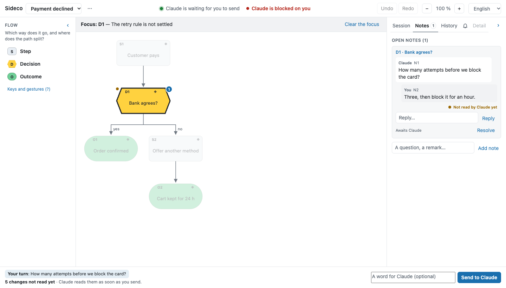
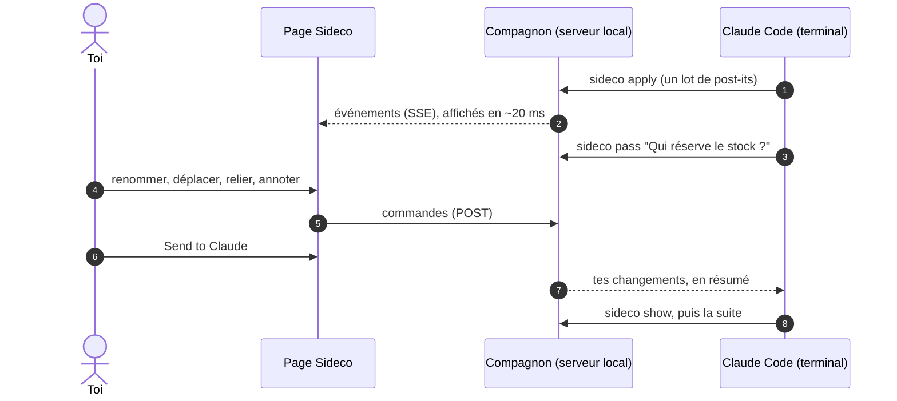
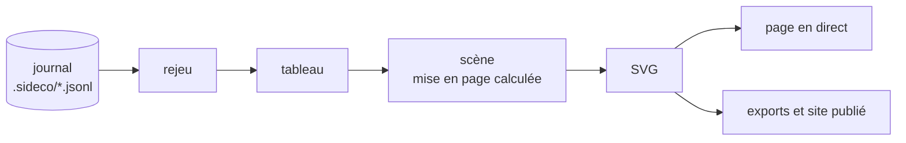

# Sideco · guide détaillé

Ce guide détaille Sideco en français. L’accueil, en anglais, est dans le [README](../README.md). Un [guide plus court](guide.md) existe en anglais.

Sideco est le compagnon visuel de Claude Code : une page web locale, ouverte à côté du terminal, où toi et ton agent construisez le même modèle (event storming, flux, kanban, story map, rétrospective, impact / effort) pendant que l'agent travaille.



<sub>Source : `bun scripts/screenshots.ts docs/img`, qui photographie la page actuelle. Qui a posé une carte se lit dans son info-bulle.</sub>

**Complète** le terminal, ne le remplace pas : la conversation reste dans Claude Code.

| Où | Ce qui s'y fait |
| --- | --- |
| Terminal (Claude Code) | Prompts, réponses, permissions, code : inchangé |
| Page Sideco | Modifier le tableau, épingler une note, passer la main ; suivre la session en lecture seule |
| ❌ Hors périmètre | Saisir un prompt dans la page, piloter le terminal, relire tout le transcript |

## Démarrer

Il faut [Bun](https://bun.sh) 1.4 ou plus récent. Aucune autre dépendance à l'exécution. Claude Code installe le plugin depuis GitHub, sans clone :

```sh
claude plugin marketplace add bastien-gallay/sideco && claude plugin install sideco@sideco
```

Sans Bun, la même ligne l'installe d'abord : `curl -fsSL https://bun.sh/install | bash && …`. S'il manque, `sideco` le dit et donne cette commande, au lieu de `bun: not found`. Installé dans `~/.bun/bin` mais absent du `PATH` du shell d'un hook, il est trouvé quand même.

Pour essayer un clone sans l'installer, dans ton projet :

```sh
cd /chemin/vers/ton-projet
claude --plugin-dir /chemin/vers/sideco
```

Demande ensuite, dans le terminal : « modélisons le passage de commande sur le tableau ». Tu n'as rien d'autre à lancer :

| Étape | Qui | Comment |
| --- | --- | --- |
| Créer l'espace de travail `.sideco/` | Claude | `sideco open`, première étape du skill |
| Démarrer le compagnon | Claude, ou le plugin au début de chaque session suivante | `sideco open`, hook `SessionStart` |
| Ouvrir la page dans ton navigateur | Claude | `sideco open` ; une page déjà ouverte est laissée telle quelle, y compris après un redémarrage du compagnon : la commande attend jusqu'à 8 s que l'onglet resté ouvert se reconnecte avant d'en ouvrir un autre |
| Poser les premiers post-its | Claude | `sideco apply` |

Tu peux aussi l'ouvrir toi-même, à tout moment : `/chemin/vers/sideco/bin/sideco open`. La variable `BROWSER` choisit le navigateur.

Un clone est aussi sa propre place de marché, pour installer ta version locale :

```sh
claude plugin marketplace add /chemin/vers/sideco
claude plugin install sideco@sideco
```

Claude Code copie alors le plugin dans son cache : après une modification du dépôt, monte la version dans `.claude-plugin/` puis lance `claude plugin marketplace update sideco` et `claude plugin update sideco@sideco`. Pendant que tu développes Sideco, `--plugin-dir` reste le plus direct.

Une page restée ouverte suit la mise à jour : quand le compagnon redémarre avec une autre page que celle de l'onglet, l'onglet se recharge de lui-même. Si tu es en train d'écrire (réponse non envoyée, champ rempli, dialogue ouvert), il attend : il affiche « Sideco was updated. » avec le bouton `Reload`, et se recharge de lui-même dès que plus rien n'est à perdre, par exemple une fois la réponse envoyée.

Pour taper `sideco` sans son chemin dans ton propre terminal, pose un lien : `ln -s /chemin/vers/sideco/bin/sideco ~/.local/bin/sideco`. Dans la session Claude Code, le plugin le met déjà sur le `PATH`.

## La boucle

**Lis** le schéma comme un tour de table : chacun modifie le tableau, puis passe la main.



<sub>Source : `src/server/http.ts`, `src/cli/hook.ts` ; latence mesurée par `tests/e2e/companion.test.ts` (22 ms le 2026-11-18, sur cette machine).</sub>

Tes changements reviennent à Claude par quatre canaux, selon ce qu'il fait à ce moment-là :

| Claude… | Canal | État |
| --- | --- | --- |
| attend ta réponse (`sideco wait`) | la commande se débloque et affiche le résumé | ✅ testé |
| reçoit ton prochain message | le résumé est joint au contexte (hook `UserPromptSubmit`) | ✅ testé |
| est en train de travailler | le résumé arrive après son outil en cours (hook `PostToolUse`), si tu as passé la main | ✅ testé |
| est au repos, page ouverte | il est réveillé (hook `Stop` avec `asyncRewake`), jusqu'à 12 h après son dernier tour, ou jusqu'à la fermeture de la session | ✅ essayé en session réelle, Claude Code 2.1.326, après quelques minutes de repos ; ⚠️ au-delà de 6 min : corrigé le 2026-11-18, pas encore réessayé en session réelle |

Plusieurs sessions dans le même projet : le passage de main va à une seule : depuis la page, celle choisie en haut, sinon celle à qui est le tableau (la dernière à y avoir écrit, si elle tourne encore) ; le survol du bouton la nomme (`Pour la session dossier · id` en français), et le bouton lui-même dès qu'il y a un choix (`Send to Claude · nom`). Seule celle-là est réveillée. Une autre se vise par `sideco pass --to agent --for SESSION`. `sideco sessions` liste les sessions ouvertes, ce que chacune suit, et marque la tienne ; Une session porte le nom que Claude Code lui donne (`/rename`) ; sinon `sideco session name "atelier"` lui en donne un, à la place du début de son id.

Chacun de tes messages rappelle aussi à Claude l'adresse du compagnon de ce projet, en une ligne que tu ne vois pas, même après un compactage de la conversation. Quand il cite un tableau ou une carte dans sa réponse, il en fait un lien : `[T152](http://127.0.0.1:4747/#/b/backlog/T152)`. Un clic ouvre la page sur cette carte. `sideco url T152 --board backlog` imprime cette adresse, et `sideco show T152` la donne sous sa première ligne quand le compagnon tourne.

Pour voir toi aussi l'adresse du compagnon, ajoute-la à la ligne d'état de Claude Code. `sideco statusline` lit la session que Claude Code lui passe et affiche `sideco · 127.0.0.1:4747`, cliquable (Cmd+clic) dans les terminaux qui le permettent (iTerm2, Kitty, WezTerm ; pas Terminal.app). Elle n'affiche rien hors d'un projet Sideco et ne démarre jamais le compagnon. Un plugin ne peut pas poser la ligne d'état : elle se règle dans `~/.claude/settings.json`. Demande à Claude de lancer `sideco statusline --install` : sans ligne d'état à toi, la commande pose celle de Sideco, en gardant le reste du fichier (sous `CLAUDE_CONFIG_DIR` s'il est défini). Elle vise le binaire de la place de marché, qui survit aux mises à jour, plutôt que la copie numérotée par version :

```json
{ "statusLine": { "type": "command", "command": "~/.claude/plugins/marketplaces/sideco/bin/sideco statusline" } }
```

Avec un script à toi, elle n'y touche pas et imprime les deux lignes à lui ajouter à la fin : l'adresse vient en dernière ligne de la barre, seulement dans un projet Sideco. Le script reçoit la session sur stdin, et la garde dans `$input` :

```bash
sideco_line=$(printf '%s' "$input" | ~/.claude/plugins/marketplaces/sideco/bin/sideco statusline 2>/dev/null)
[ -z "$sideco_line" ] || printf "%s\n" "$sideco_line"
```

Si l'adresse s'affiche sans réagir au Cmd+clic, Claude Code n'a pas reconnu un terminal à liens : force-le dans ton shell, une fois pour toutes.

```bash
echo 'export FORCE_HYPERLINK=1' >> ~/.zshrc
```

| Où | État |
| --- | --- |
| iTerm2 3.5, `FORCE_HYPERLINK=1`, ajoutée à un script existant | ✅ essayé le 2026-11-21 : cliquable |
| Kitty, WezTerm | ❓ cités par la documentation de Claude Code, pas essayés |
| Terminal.app | ❌ pas de lien, l'adresse reste lisible |
| tmux, SSH | ⚠️ peuvent retirer le lien |

<sub>Source : `src/cli/statusline.ts` ; liens OSC 8 et `FORCE_HYPERLINK` : code.claude.com/docs/en/statusline, lue le 2026-11-21. Le chemin est celui d'une installation depuis GitHub ; `sideco statusline --install` imprime le bon pour la tienne.</sub>

Le résumé est net des allers-retours : un post-it ajouté puis renommé se lit comme un seul ajout. Signes : `+` ajouté, `−` supprimé, `~` modifié, `→` déplacé.

## Dans la page

| Geste | Effet |
| --- | --- |
| Cliquer un type dans la palette | Ajoute un post-it à la suite (ou relié au nœud sélectionné, dans un flux) |
| Survoler une case ou une colonne, cliquer le « + » | Ajoute un post-it à cet endroit : du type de la rangée dans une frise, du type choisi (un « + » par type) dans une colonne. Double-cliquer une zone vide fait de même |
| Dans une frise, survoler entre deux numéros d'étape, cliquer le « + » | Insère une colonne à cet endroit : les étapes suivantes se décalent d'un cran ; Undo la retire. Une étape vide se retire par le « × » qui apparaît en haut de l'étape quand on la survole, ou par `sideco rm-col N` ; Undo la remet. Glisser l'en-tête d'une étape, n'importe où sauf tout près d'un bord où s'offre l'insertion, la déplace, ses cartes avec elle (`sideco move-col DE VERS`). ⚠️ Aucun raccourci clavier |
| Double-cliquer une carte | La renomme |
| Kanban et rétro : survoler l'espace entre deux en-têtes, cliquer le « + » | Ajoute une colonne à cet endroit, à nommer. Une colonne vide offre un « × » dans son en-tête ; glisser un en-tête déplace la colonne avec ses cartes. Au clavier, chaque en-tête est un arrêt de Tab : Entrée renomme, `Maj` + `←` `→` déplace, `Suppr` supprime si vide, `+` ou `Alt` + `←` `→` ajoute une colonne, `↓` va aux cartes. Claude : `sideco lane add "Nom" [--before L]`, `lane rm L`, `lane move L [--before L]`. Tout s'annule |
| Rétro : sélectionner un constat, « En faire une action » | Ouvre la saisie d'une action dans Try, reliée au constat. Une action ajoutée sans colonne va aussi dans Try. Claude : `sideco add action "…" --from Q1` |
| Pointer l'en-tête d'une colonne (kanban, rétro), puis son chevron `‹` ; au clavier, `Tab` jusqu'au chevron puis `Entrée` ou `Espace` | Replie la colonne en une bande étroite : son compte, son nom debout, ses cartes rangées. Un clic n'importe où sur la bande, ou son chevron `›`, la rouvre. Le repli est le tien : gardé dans ce navigateur, tableau par tableau, il n'est ni dans le journal ni dit à Claude, et un export dessine toutes les colonnes ouvertes. Une carte choisie dans une colonne repliée (recherche, déplacement au clavier) la rouvre ; une carte lâchée sur la bande va à la fin de la colonne. Les cases d'un plan Impact / Effort ne se replient pas |
| Double-cliquer le nom d'une colonne (kanban, rétro, Impact / Effort) | Renomme la colonne pour ce tableau ; Entrée valide, Échap abandonne. ⚠️ Revenir au nom de l'atelier ne se fait que par Undo |
| Glisser une carte | La change d'étape ou de colonne, ou de place dans sa case ; une ligne montre où elle tombera. La position reste sémantique, jamais en pixels, sauf sur un `flow` ou un `c4-context` : la carte se pose là où on la lâche, et le diagramme passe en Snap |
| Sur une carte qui a le focus, `Alt` + flèche (`⌥` sur Mac) | Ajoute une carte du même type à côté, du côté de la flèche, et ouvre sa saisie : étape ou colonne voisine à gauche et à droite, juste au-dessus ou au-dessous dans la même case ; dans un flux, `→` et `↓` ajoutent l'étape suivante, reliée. Un seul Undo la retire. Claude fait de même par `sideco add … --before ID` |
| Carte choisie, touche `F`, ou le bouton `Put in the focus (F)` de l'onglet `Detail` | Vise la carte, comme Claude le fait par `sideco focus` : elle rejoint ce qui est déjà visé, pour la même raison, et les autres cartes s'estompent. Le même geste l'en sort. Le bandeau au-dessus du tableau dit ce qui est visé et porte trois boutons : `Copy the link` copie l'adresse de la carte visée (du tableau quand il y en a plusieurs : il montre son focus), `Put aside` met le focus de côté sur ta page seulement, sans le lever (le tableau se montre entier, Claude et les autres pages gardent le focus, le bandeau le rappelle et `Show it` le ramène ; un focus posé de nouveau se montre toujours), `Clear the focus` le lève pour tous. |
| Sélectionner une carte | Sa barre se pose à côté d'elle, plus étroite qu'elle : quatre dessins au plus, un crayon (`Rename`, Entrée), une page (`Detail`, `E`, en couleur quand la carte a un détail), un plus quand la carte mène à une autre (une tâche depuis une story, une action depuis un point de rétro), une bulle (`Note for Claude`, `N`), puis `⋯`. Le survol dit le mot et sa touche ; un lecteur d'écran entend le mot. |
| Sélectionner une carte, « Mark done » sous le `⋯` de sa barre (avec « Link » et « Remove »), ou la touche `d` | La marque comme faite : une coche et le libellé barré. Le même geste retire la marque ; Claude le fait par `sideco done ID` et `sideco undone ID`. Sur un kanban, « fait » est la dernière colonne : le geste y envoie la carte, ou la remet dans la colonne d'avant, sans coche |
| Sélectionner une carte | Barre d'actions : renommer, détail, relier, note pour Claude, supprimer |
| Cliquer un lien, puis « Name » ; ou double-cliquer un lien | La barre du lien s'ouvre à côté du trait, là où elle ne cache aucune carte. « Reverse » y retourne le lien : sa source devient sa destination, son nom gardé, et un seul Undo le remet ; Claude le fait par `sideco reverse SRC DST`. Si un lien va déjà dans l'autre sens, le bouton le dit et ne fait rien. Nomme le lien : dans un flux, la branche d'une décision (`oui`, `non`). Le nom se pose à côté de la flèche, juste au-dessus de la carte visée ; s'il y gênerait une carte ou un autre nom, il glisse le long de son lien jusqu'à une place libre, et sans place libre il ne s'écrit pas : il se lit au survol du lien. Vidé, le nom part ; Undo le rend. Claude : `sideco link SRC DST "nom"` sur un lien déjà posé le renomme. Au clavier : la section « Liens » de l'onglet `Detail` (voir plus bas) |
| Cliquer un lien, puis tirer un de ses deux bouts | Le lien choisi porte un point à son départ et un à sa flèche. Tiré jusqu'à une autre carte, le bout s'y rebranche : l'autre bout et le nom du lien sont gardés, et un seul Undo le remet. La carte visée s'entoure ; rien ne se passe sur la carte de l'autre bout, ni là où un lien existe déjà. Claude le fait par `sideco relink SRC DST --to ID` (la flèche) ou `--from ID` (le départ). Au clavier, la page n'a pas ce geste : retire le lien puis repose-le (section « Liens » de l'onglet `Detail`). |
| Carte choisie, tirer le point sur son bord droit jusqu'à une autre carte | Relie les deux cartes : un fil en pointillés suit le pointeur et finit par une flèche, comme le lien qu'il posera, et la carte visée s'entoure. Tenu près d'un bord du tableau, le fil fait défiler le tableau vers les cartes hors de vue, plus vite à mesure qu'il s'approche du bord. Lâché n'importe où sur elle, il pose le lien ; si la carte choisie y pointe déjà, le fil vire au rouge et lâcher retire le lien. Lâché là où il n'y a pas de carte, le fil revient vers le point en s'effaçant. Échap lâche le fil sans rien changer. Le point grossit sous le pointeur, et le doigt le prend dans un cercle de 24 px. Un lecteur d'écran entend le lien posé ou retiré, ou « Aucune carte visée ». Le milieu d'une carte reste à la déplacer ; au clavier, `L` puis la carte visée : tant que le lien se tire ainsi, le pied du tableau dit « Choisis la carte d'arrivée · Échap annule » |
| Pointer une carte liée, la choisir, ou cliquer un lien | Le phare : ce que tu regardes reste net, ses liens passent en couleur d'accent avec un point à leur départ, et le reste s'efface, les autres liens presque tout à fait, les autres cartes à moitié. Le pointeur l'emporte sur le lien cliqué, qui l'emporte sur la carte choisie ; une carte sans lien laisse le phare où il était. Échap ou un clic dans le vide l'éteint |
| Cliquer `Sideco` en haut à gauche, ou `Every board` en tête du sélecteur de tableaux | Ouvre l'accueil (`#/boards`) : une tuile par tableau, avec les couleurs de son atelier, son nom, son atelier, ses cartes, ses notes ouvertes et « Claude waits for you here » là où Claude t'attend ; un clic l'ouvre. Dessous, les ateliers pour en commencer un autre. Un tableau que Claude crée pendant ce temps s'y ajoute sans t'en sortir |
| Onglets `Session`, `Notes`, `History`, la cloche et `Detail`, à droite | `Session` montre ce que fait Claude. Choisir une carte depuis `Session` ouvre `Detail`, et la laisser rend `Session` ; depuis `Notes` ou `History`, tu y restes (le `≡` d'une carte ou `E` ouvrent son détail quand même). Tant qu'elle reste choisie, l'onglet que tu prends reste le tien. Sans carte choisie, `Detail` est grisé et les flèches le passent. Panneau replié, les onglets restent dans le rail : un clic le rouvre sur l'onglet. Sous 1100 px de large, les deux panneaux se replient d'eux-mêmes ; une carte choisie depuis `Session` déplie alors le panneau sur son détail, et le replie quand tu la laisses |
| Carte choisie, onglet `Detail`, section « Liens » | Chaque lien de la carte, ceux qui en partent (→) puis ceux qui y mènent (←), avec la carte à l'autre bout et le nom du lien. `Name` ouvre un champ dans la ligne : Entrée garde le nom, vidé il part, Échap le laisse tel qu'il était, et le clavier revient sur `Name`. `Reverse` retourne le lien, et le clavier reste sur `Reverse`, dans la ligne redite dans l'autre sens. `Remove the link` le retire ; Undo le rend. C'est le chemin du clavier jusqu'à un lien |
| Carte choisie, onglet `Detail` | Le nom de la carte, son type, puis une ligne qui dit qui l'a ajoutée, qui l'a changée en dernier et quand (l'heure pour aujourd'hui, le jour avant), et qu'elle est faite ; enfin son détail en entier. Le détail s'écrit là où il se lit : `Edit the detail` (`Add a detail` s'il n'y en a pas), `Detail` dans la barre de la carte ou la touche `E` ouvrent un champ à sa place, qui grandit avec le texte. Entrée passe à la ligne, `⌘` / `Ctrl` + Entrée enregistre, Échap laisse le détail tel qu'il était ; une autre carte choisie entre-temps attend que tu aies fini. Le détail se lit en markdown simple : `**gras**`, `*italique*`, `` `code` ``, listes en `-` ou `1.`, bloc entre ```` ``` ````, liens `[mots](https://…)` vers le web ou une adresse mail ; le HTML s'affiche tel quel, en mots |
| Pastille « Claude waits », au centre de la barre du haut | À côté de ce que fait Claude, quand Claude t'a passé la main : sur le tableau à l'écran ou sur un autre, qu'elle nomme et ouvre d'un clic. Son point s'anime doucement, sauf si le système demande moins de mouvement |
| Sélecteur de session, en haut à droite | Dès que deux sessions Claude Code ouvertes sur le projet ont reçu un prompt, il les nomme (nom donné dans Claude Code par `/rename`, sinon `sideco session name "Nom"`, sinon le début de leur id). Un `claude` lancé et laissé sans prompt n'y figure pas. Celle choisie, gardée d'une visite à l'autre, est celle dont parlent l'état de Claude, l'onglet `Session` et le compte de ce qu'il n'a pas lu. Sans choix, la page montre la session du tableau affiché |
| Onglet Notes, à droite | L'onglet compte les fils ouverts, sur fond bleu quand l'un attend ta réponse ; il s'ouvre seul quand Claude écrit une note qui t'attend, et quand tu cliques le compteur d'une carte ou le lien « notes ouvertes sur cette carte » du détail. Chaque note ouvre un fil : la carte concernée en tête, les messages dans l'ordre avec leur auteur et leur identifiant, un champ pour répondre (Entrée envoie, Maj+Entrée passe à la ligne, `⌘↵` / `Ctrl+Entrée` envoie puis passe la main à Claude, la réponse avec), et qui est attendu. Cliquer l'en-tête du fil montre la carte sans quitter l'onglet ; sélectionner une carte encadre ses fils. `Resolve` ferme le fil entier ; avec une réponse dans le champ, il devient `Reply and resolve` et l'envoie d'abord |
| Onglet `History`, à droite | Les événements du tableau affiché, le plus récent en haut, avec l'heure et la phrase qui les dit. Un clic sur un événement montre le tableau tel qu'il l'a laissé, en lecture seule ; `↑` et `↓` passent au moment suivant ou précédent, comme `◄` et `►` en tête de l'onglet. `Everything` parcourt tout le journal (autres tableaux, session), `This board` revient au tableau ; la ligne `Back to live` en haut de la liste, ou le bandeau sur le tableau, revient au présent. 200 événements à la fois, `Earlier…` en montre plus |
| Cloche, onglet `Notifications`, à droite | Tout ce que la page t'a dit en bas, le plus récent en haut, avec l'heure ; la cloche compte ce que tu n'as pas encore vu, en rouge s'il y a une erreur. Une offre (`Undo`, `Reload`) s'y presse encore tant que tu n'as pas fait d'autre geste : après, `Undo` défairait ce geste-là, alors elle part, du toast aussi. Une erreur reste dans sa barre rouge, au-dessus du toast, jusqu'à ce qu'un envoi passe ou que tu cliques `Dismiss` |
| `Undo` / `Redo`, ou `⌘Z` / `⇧⌘Z` (`Ctrl+Z` / `Ctrl+Shift+Z`) | Annule ou rétablit ton dernier geste sur le tableau affiché : ajout, renommage, détail, déplacement, suppression, lien. Jamais un geste de Claude. Un geste que Claude a modifié depuis est refusé, et le refus le dit ; l'Undo suivant prend le geste d'avant. Claude annule les siens par `sideco undo` (`--dry-run` montre le geste sans l'annuler), avec la même règle |
| `?`, ou « Keys and gestures » dans la palette | Les touches et gestes du tableau affiché, puis « On a card » : chaque marque d'une carte dessinée comme sur la carte, avec son sens (◆ ou ● pour qui l'a ajoutée, `≡` détail, `✓` faite, pastille bleue des notes ouvertes, point ambre pas encore lu par Claude, triangle bleu changée depuis ta visite) |
| `‹` / `›` dans le coin d'un panneau latéral, ou les touches `<` et `>` (`[` et `]` aussi) | Replie le panneau en rail, ou le rouvre. Replié, le rail de gauche garde les types : un clic ajoute encore une carte. Le navigateur garde ce choix ; sous 1 100 px de large, les deux panneaux se replient d'eux-mêmes |
| Menu `⋯`, à côté du choix du tableau | `New board…` crée un tableau ; `Export` donne le tableau courant en Markdown, HTML, SVG, Mermaid ou modèle JSON, dans la langue de la page ; `Remove this board…`, en dernier, le supprime après confirmation, et `Undo` le fait revenir entier. Échap ou un clic ailleurs referme le menu |
| Pastille au coin d'une carte, `Not read by Claude yet` sous un fil | Rien à faire : c'est un rappel de ce que tu as changé et que Claude n'a pas encore lu. Sont marqués les cartes et les fils que nomme le résumé qu'il recevra, net des allers-retours comme lui ; la marque part dès que le résumé est remis à la session. L'historique n'en montre pas |
| `Send to Claude` | Envoie tes changements, avec un mot facultatif, à la session choisie en haut ; sans choix, à celle du tableau. Avec plusieurs sessions, le bouton dit laquelle ; son survol le dit toujours |
| Sélecteur `English` / `Français`, en haut à droite | Change la langue de la page ; le choix est gardé par ce navigateur |

### Langue

La page, le dessin et les exports sont en anglais par défaut ; le français est l'autre langue fournie. Ce que tu écris sur un post-it n'est jamais traduit.

| Qui lit | Langue | Comment la changer |
| --- | --- | --- |
| Toi, dans la page | anglais | le sélecteur de la page (gardé par le navigateur) ; `SIDECO_LANG=fr` au démarrage du compagnon change la langue d'ouverture |
| Le lecteur d'un export ou du site publié | anglais | `--lang fr` sur `sideco export` et `sideco publish`, ou `SIDECO_LANG=fr` |
| L'agent, dans le terminal (`sideco show`, `sideco changes`, erreurs) | anglais, toujours | ne se change pas : un seul vocabulaire à apprendre pour l'agent |

<sub>Source : `src/domain/i18n.ts`, `src/web/messages.ts`, `src/cli/main.ts` (`language`) ; `tests/unit/i18n.test.ts`, `tests/integration/cli.test.ts`, `tests/e2e/companion.test.ts`, exécutés le 2026-11-18.</sub>

## Les ateliers

Un atelier est une donnée (un fichier par atelier dans `src/domain/formats/`, listés par `src/domain/formats.ts`), pas un moteur de rendu : types de post-its, couleurs, mise en page.

| Atelier | Question posée | Mise en page | Types (préfixe des identifiants) |
| --- | --- | --- | --- |
| `event-storming` | Que se passe-t-il dans le domaine, dans quel ordre ? | étapes | `actor` `X`, `command` `C`, `aggregate` `A`, `event` `E`, `policy` `P`, `readmodel` `R`, `system` `G`, `hotspot` `H` |
| `flow` | Par où passe-t-on, où le chemin se sépare-t-il ? | graphe | `step` `S`, `decision` `D`, `outcome` `O` |
| `kanban` | Où en est le travail, qu'est-ce qui le bloque ? | colonnes | `story` `S`, `task` `T`, `blocker` `B` |
| `story-map` | Quel parcours, que livre-t-on d'abord ? | étapes | `activity` `A`, `task` `T`, `story` `S` |
| `retro` | Que garde-t-on, qu'arrête-t-on, qu'essaie-t-on ? | colonnes | `point` `P`, `action` `A` |
| `impact-effort` | Que fait-on d'abord, pour ce que ça rapporte et ce que ça coûte ? | colonnes, en plan 2 × 2 | `item` `I` |
| `c4-context` | Qui utilise le système, et de quoi dépend-il ? (C4, niveau 1) | graphe | `person` `P`, `system` `Y`, `external` `X` |

Un `flow` trop long pour tenir en hauteur se replie, si la fenêtre est assez large, en colonnes côte à côte : on lit la première de haut en bas, puis la flèche monte par l'allée et reprend en haut de la suivante. Le repli ne coupe qu'à un endroit où une seule flèche passe, jamais sous une boucle qui remonte, et suit la largeur de la fenêtre ; les exports gardent une seule colonne.

Un `flow` ou un `c4-context` peut aussi passer en **Snap** : ses cartes restent où tu les poses. Glisse une carte, pousse-la avec `Maj` et une flèche, presse le bouton Snap de la palette, ou dis `sideco place ID X Y` : tout le diagramme se fige là où il se tient, avec la hauteur que les liens donnaient aux cartes. Un lien ajouté ensuite ne déplace plus aucune carte, et se trace en courbe. Une carte ajoutée se met sous celle d'où elle part, à la première place libre. Claude apprend la carte posée et le passage en Snap, pas chaque carte restée en place, et `sideco show` lui dit où est chaque carte. Snap relâché, ou `sideco placing auto`, rend le placement aux liens ; les places posées reviennent avec Snap ou `sideco placing hand`.

Sur un `c4-context`, le détail d'une carte est sa description : la carte en montre le début sous son nom, en plus petit, trois lignes au plus (`sideco detail Y1 "Catalogue, panier, paiement"`). Une personne porte une tête et des épaules au-dessus de son nom. Exporté en `svg`, `md` ou `html`, un C4 part avec son titre (« Contexte du système : Boutique ») et sa légende, les trois sortes de cartes nommées, comme le demande la notation.

Sur une `story-map`, quand le tableau défile vers le bas et que les activités passent sous les numéros d'étape, chaque numéro affiche dessous l'activité et la tâche de son étape ; l'activité court jusqu'à l'étape qui en a une autre.

Une `story-map` se découpe en tranches : `sideco slice add "Lot 1" [--before slice-N]` trace sous les stories un trait pointillé nommé ; ce qui est au-dessus se livre d'abord. `sideco slice rm slice-N` le retire, et Undo reprend l'un comme l'autre. ⚠️ Premier pas : ranger une story dans une tranche, et le faire depuis la page, viendront ensuite.

`impact-effort` se dessine comme la matrice 2 × 2 : impact fort en haut, effort faible à gauche, les deux axes nommés à côté, avec « faible » et « fort » à leurs deux bouts. Le nom d'une case reste en vue quand le tableau défile, de haut en bas comme de côté. Chaque case dit sous son nom l'impact et l'effort qu'elle représente, et tient deux cartes de front. Pour Claude et pour les exports, les quatre cases restent quatre couloirs (`quick`, `bet`, `fill`, `avoid`).

Sur un `kanban`, une tâche liée depuis une story la découpe (`sideco add task "Brancher la banque" --from S1`, ou « Split into a task » dans la barre de la story). La story porte alors, à côté de son id, le compte de ses tâches faites (`1/2`), et la tâche l'id de sa story (`↳ S1`, ou `↳ S1 +1` si elle en découpe deux) ; l'infobulle et l'onglet `Detail` le disent en mots (« Story · 1 of 2 tasks done », « Task · splits S1 Payer en ligne »). Un autre lien, d'une tâche à une tâche ou vers un blocage, reste un lien.

Un tableau peut dire ses propres mots à la place de ceux de l'atelier : `sideco lane hint quick "Interne · positif"` change le sous-titre d'une case, `sideco axis y "Origine" "Externe" "Interne"` nomme un axe et ses deux bouts (gauche puis droite, bas puis haut). Un bout omis reste ce qu'il était ; un texte vide (`""`) rend les mots de l'atelier. `sideco purpose "Où en est-on face au marché ?"` lui donne sa propre question, montrée dans la palette à la place de celle de l'atelier. C'est ce qui permet de poser un SWOT sur ce plan. Dans la page, un double-clic sur un sous-titre, sur le nom d'un axe ou sur l'un de ses bouts l'ouvre à l'écriture ; vidé, il rend les mots de l'atelier. Une colonne sans sous-titre affiche « Add a subtitle » quand le pointeur passe sur son en-tête ; au clavier, `Maj+Entrée` sur l'en-tête d'une colonne de kanban fait de même. Les mots d'un axe s'atteignent aussi par `Tab` : `Entrée` ou `F2` les ouvre à l'écriture.

| Colonne | `--lane` | Impact | Effort |
| --- | --- | --- | --- |
| Gains rapides | `quick` | fort | faible |
| Gros paris | `bet` | fort | fort |
| Remplissage | `fill` | faible | faible |
| À éviter | `avoid` | faible | fort |

<sub>Source : `sideco formats` ; `src/domain/formats.ts`.</sub>

## La ligne de commande

`sideco help` donne la liste complète. L'essentiel :

```sh
sideco open                       # démarre le compagnon et ouvre la page, si elle ne l'est pas déjà
sideco status                     # tableaux, session, serveur
sideco show                       # le tableau en texte, comme l'agent le lit
sideco export --format md -o docs/design/commande.md
sideco export --format md --lang fr   # le même, en français
sideco export --format json -o commande.json   # le modèle, version 2 ; sideco import commande.json le refait (un fichier sans version se lit en version 1)
sideco board rm brouillon         # supprime un tableau ; son histoire reste dans le journal
sideco publish                    # tous les tableaux en site statique, sous .sideco/site
sideco stop                       # arrête le compagnon ; le journal reste (il s'arrête aussi seul, 5 min après la dernière page et la dernière session)
```

L'agent, lui, écrit par lots, tout ou rien :

```sh
sideco apply <<'EOF'
board new "Passage de commande" --format event-storming
add command "Passer commande" --col 1 --alias passer
add event "Commande passée" --col 1 --alias passee
link @passer @passee
EOF
```

Sideco attribue les identifiants (`C1`, `E1`) en appliquant le lot : une ligne ne peut pas connaître celui de la ligne d'avant. Elle la nomme.

| Dans un lot | Effet |
| --- | --- |
| `add … --alias NOM`, `note … --alias NOM` | Nomme la carte ou la note créée : minuscules, chiffres et tirets |
| `@NOM` à la place d'un identifiant | Vaut l'identifiant de ce qui porte ce nom, dans les lignes suivantes du même lot |
| ❌ `@NOM` jamais donné plus haut, ou nom donné deux fois | Le lot entier est refusé, l'erreur dit quelle commande |

Un nom ne vit que le temps de son lot : le journal ne garde que les identifiants.

<sub>Source : `src/domain/aliases.ts` ; `tests/unit/aliases.test.ts`, `tests/unit/hub.test.ts`, `tests/integration/cli.test.ts`.</sub>

### Les labels

Un label est un mot libre posé sur une carte. Il n'appartient à aucun tableau : `type:bug` sur le backlog et sur un flow est le même label. Ils servent là où un tableau simple ne suffit pas : à qui est la carte, quel genre de travail, quelle version, quel environnement.

```sh
sideco label T3 type:bug @bastien release:0.4   # @bastien vaut assignee:bastien
sideco unlabel T3 release:0.4
sideco labels                                    # chaque label et ses cartes, tous tableaux confondus
sideco labels type                               # tous les type:…
sideco colour type teal                          # tous les type:… en sarcelle, sur tous les tableaux
sideco colour type auto                          # la couleur de type: rendue au hasard
```

La casse ne compte pas (`Type:Bug` est `type:bug`). `sideco show` met les labels en fin de ligne de chaque carte. Ils s'annulent, reviennent avec une carte restaurée et se gardent à l'export du modèle.

Dans la page, une carte porte ses labels en puces à son pied, autant qu'il en tient, puis « +N » ; tous les labels d'une même clé ont la même couleur, et la puce n'en dit que la valeur (`bug` pour `type:bug`, `@bastien` pour `assignee:bastien`). L'infobulle, le nom lu et l'onglet `Detail` les disent en entier. L'onglet `Detail` de la carte choisie les montre tous : × en retire un, le champ « Add a label » en ajoute (plusieurs à la fois, séparés par des virgules ; Entrée valide) et propose ceux que le projet utilise déjà. Depuis une carte, `T` y mène tout droit : la carte est choisie, son onglet `Detail` ouvert, le clavier dans le champ. Échap vide le champ ; vide, il rend le clavier à la carte. Échap sort aussi d'une note ou d'une réponse, en gardant les mots commencés : le clavier revient sur le tableau, à la carte choisie, sinon à la première. Du détail, Échap sort sans enregistrer et rend le clavier là d'où il venait, la carte ou le bouton du panneau.

La couleur d'un label vient de sa clé, ce qui précède `:` (`type`, `epic`, `assignee` pour `@nom`), ou de ses mots quand il n'a pas de clé. Sans choix, le hasard la donne, et deux clés sans rapport peuvent tomber sur la même. Pour la choisir : dans l'onglet `Detail`, le point au début d'une puce ouvre les huit couleurs de sa clé (`blue`, `green`, `purple`, `orange`, `teal`, `pink`, `olive`, `grey`) et `Auto`, qui la rend au hasard ; Échap les range. Le choix vaut pour tous les labels de la clé, sur tous les tableaux du projet, dans la page comme dans les exports. Il est gardé dans `boards.jsonl` avec l'histoire des tableaux, et `sideco labels` le rappelle en dernière ligne. ⚠️ Il ne s'annule pas par `Undo` : il se rechoisit. Il n'est pas dit à Claude parmi tes changements, et l'historique le montre quand il porte sur tout le projet, pas sur un seul tableau. Le passé se regarde avec les couleurs qu'il avait.

Une puce pressée, sur la carte ou dans l'onglet `Detail`, filtre le tableau sur son label : les cartes qui ne le portent pas s'effacent sans bouger, et une barre posée sur le coin du tableau dit le label et combien de cartes le portent (« 2 cartes sur 3 »). `@bastien` donne ainsi « mes cartes ». La même puce pressée à nouveau, ou « Tout montrer », rend toutes les cartes. Le filtre suit d'un tableau à l'autre, et ne dure que le temps de la page.

<sub>Source : `src/domain/workspace.ts` (`normalLabel`), `src/domain/digest.ts` (`describeLabels`) ; `tests/unit/labels.test.ts`.</sub>

### Retrouver une carte

`sideco find` cherche dans tous les tableaux les cartes qui portent chacun des mots, dans leur nom, leurs labels, leur détail ou leurs notes. Une ligne par carte, le tableau et l'id d'abord, pour enchaîner sur `sideco show ID`.

```sh
sideco find paiement                  # toutes les cartes qui en parlent
sideco find stock reserver            # les deux mots, dans n'importe quel ordre ; ni casse ni accents
sideco find T100 --board backlog      # la carte T100 et celles qui la citent, jamais T1000
```

Quand le mot n'est pas dans le nom, la ligne dit où il est : `[labels]`, `— detail: …les mots autour…` ou `— note N3: …`.

Dans la page, `/` ou `⌘K` (`Ctrl+K` hors Mac) ouvre la même recherche au-dessus du tableau. Les cartes trouvées se listent au fil de la frappe : celles du tableau affiché d'abord, la carte de cet id en tête, puis celles des autres tableaux, chacune avec le nom de son tableau et, si le mot n'est pas dans son nom, l'endroit où il est. Les flèches choisissent ; une carte du tableau affiché est pointée sur le tableau. Entrée, ou un clic, va à la carte : la page ouvre son tableau s'il le faut, et le clavier se pose sur elle. Échap referme.

Chaque carte a son adresse, `#/b/TABLEAU/ID` (par exemple `http://127.0.0.1:4747/#/b/backlog/T182`) : l'adresse de la page suit la carte choisie, et l'ouvrir, collée ailleurs ou après un rechargement, ouvre son tableau, centre la carte, la choisit et la surligne un instant. `#/b/TABLEAU` seul ouvre le tableau. Un id est unique dans tout le projet ; le lien porte quand même le tableau, qu'il ouvre.

<sub>Source : `src/domain/find.ts` (`findInWorkspace`), `src/domain/digest.ts` (`describeFind`), `src/web/view.ts` (`findHits`) ; `tests/unit/find.test.ts`, `tests/unit/find-hits.test.ts`.</sub>

## Les données

Tout est un événement dans un journal en ajout seul ; le tableau, l'historique et les exports en sont des projections.



<sub>Source : `src/domain/` (`workspace.ts`, sa fonction `replay` ; `layout/`, `render/svg.ts`). Le même peintre SVG sert la page et les exports.</sub>

| Fichier | Contenu | Git |
| --- | --- | --- |
| `.sideco/boards.jsonl` | L'histoire des tableaux | ✅ à versionner |
| `.sideco/sessions.jsonl` | La trace des sessions : prompts, outils lancés, tâches | ❌ ignoré (local) |
| `.sideco/server.json` | L'adresse du compagnon en cours | ❌ ignoré |
| `.sideco/site/` | Le site publié | ❌ ignoré |

Le compagnon n'écoute que sur `127.0.0.1` et refuse les requêtes d'une autre origine.

### Venir de Vico

Sideco s'appelait Vico jusqu'au 2026-11-19.

| Ancien | Nouveau | Transition |
| --- | --- | --- |
| `.vico/` | `.sideco/` | ✅ un projet qui n'a que `.vico/` continue de le lire |
| `VICO_SESSION`, `VICO_BOARD`… | `SIDECO_SESSION`, `SIDECO_BOARD`… | ✅ l'ancienne variable compte quand la nouvelle est absente |
| commande `vico` | commande `sideco` | ✅ `bin/vico` passe la main à `sideco`, pour les sessions ouvertes avant le renommage |
| plugin `vico@vico` | plugin `sideco@sideco` | ❌ à réinstaller |

Pour passer un projet à `.sideco/`, arrête le compagnon puis renomme le dossier :

```sh
sideco stop
mv .vico .sideco
```

Pour le plugin et le lien de commande :

```sh
claude plugin uninstall vico@vico
claude plugin marketplace remove vico
claude plugin marketplace add /chemin/vers/sideco
claude plugin install sideco@sideco
rm ~/.local/bin/vico
ln -s /chemin/vers/sideco/bin/sideco ~/.local/bin/sideco
```

## Avec le bac à sable de Claude Code

Par défaut, le bac à sable de Bash bloque les connexions locales, et il interdit toujours d'ouvrir un navigateur. Les hooks du plugin n'y sont pas soumis ; les commandes `sideco` de l'agent, si.

| Commande de l'agent | Bac à sable par défaut | Avec `allowLocalBinding` |
| --- | --- | --- |
| `sideco boards`, `sideco show`, `sideco status`, `sideco export` | ✅ elles lisent le journal | ✅ |
| `sideco apply`, `sideco add`, `sideco pass`, `sideco wait`… | ❌ `this shell may not connect to the companion` | ✅ |
| `sideco open`, compagnon démarré par le plugin (hors bac à sable) | ❌ même message | ✅ le compagnon ouvre la page à la place du shell |
| `sideco open`, compagnon démarré par ce shell (premier usage dans un projet) | ❌ refusé ; ⚠️ le message `this shell may not start the companion` n'est vérifié qu'en test unitaire | ⚠️ observé le 2026-11-18 dans un projet sans `.sideco/` : l'espace de travail est créé, le compagnon démarre et son adresse s'affiche, les écritures passent ; la page ne s'ouvre pas (`could not open the browser`, code de sortie 1). Relancer `sideco open` hors bac à sable, ou ouvrir l'adresse |

<sub>Source : essais du 2026-11-18 dans une session Claude Code 2.1.326 sous bac à sable, `allowLocalBinding` activé ; colonne « par défaut » constatée le 2026-11-17.</sub>

Sur un ❌ ou un ⚠️, l'agent relance la commande hors du bac à sable (le skill le lui dit), ce qui peut demander ton accord. Le réglage qui l'évite presque toujours, dans `settings.json` :

```json
{
  "sandbox": {
    "network": { "allowLocalBinding": true }
  }
}
```

⚠️ Non essayé : `"excludedCommands": ["sideco *"]`, qui d'après la documentation de Claude Code ([sandboxing](https://code.claude.com/docs/en/sandboxing), lue le 2026-11-17) sort `sideco` du bac à sable et lèverait aussi le dernier cas.

## Développer

```sh
bun test tests/unit          # domaine, serveur, CLI, hooks, vues : sans réseau
bun test tests/integration   # le vrai binaire, un vrai port
bun test tests/e2e           # la page dans Chrome (playwright-core, Chrome installé)
SIDECO_SLOW=6 bun test tests/e2e  # la même, la page six fois plus lente : une course qui casse la CI se montre ici
bun run typecheck && bun run lint
```

| Niveau | Ce qu'il prouve | Tests | Hors bac à sable |
| --- | --- | --- | --- |
| Unitaire | Règles du domaine, mise en page, exports, hooks, contrat du plugin, textes des deux langues, annulation, fils de discussion, hauteur des cartes, écoute longue, « + » au survol, commande sans effet, fin de session, noms dans un lot, arrêts de l'historique, marque « non lu », empreinte de la page | 643 | non |
| Intégration | `bin/sideco` de bout en bout : serveur, lots, attente, hooks par stdin, publication, suppression, ouverture de la page, langue des exports et de la page servie, réponse à une note, fin de session, noms dans un lot | 45 | oui (port local) |
| Bout en bout | La page dans Chrome : ajout, glisser, renommer, notes, historique, passage de main, suppression (par Claude et depuis la page), redémarrage, bascule de langue, annuler / rétablir, fils de discussion, passage de main sans écoute, « + » au survol, carte rouverte sans changement, fil clos avec une réponse en cours, historique du tableau affiché, marque « non lu », page rechargée après une mise à jour | 66 | oui (navigateur) |

<sub>Source : exécution du 2026-11-19 (Bun 1.4.4, macOS) ; la CI GitHub Actions les relance à chaque push.</sub>

Le code suit le découpage du domaine :

| Dossier | Rôle |
| --- | --- |
| `src/domain/` | Événements, commandes, règles, ateliers, mise en page, rendu SVG, exports. Pur, sans entrée-sortie |
| `src/server/` | Journal, diffusion des événements, HTTP et SSE |
| `src/cli/` | La commande `sideco` et le traitement des hooks |
| `src/web/` | La page : TypeScript sans framework, assemblée en un seul fichier HTML |
| `hooks/`, `skills/`, `.claude-plugin/` | Le plugin Claude Code |

Le pourquoi des choix est dans [PRD.md](PRD.md).

## Limites connues

- ⚠️ Le contenu de `TodoWrite` n'est pas documenté côté hooks : les tâches sont lues prudemment, et peuvent manquer dans le panneau de session.
- La page ne reçoit les outils lancés par Claude que pour les quatre derniers tours de chaque session, ceux que montre l'onglet `Session` : c'est les quatre cinquièmes du journal en moins à l'ouverture. En remontant l'historique, un tour plus ancien montre sa demande, sans ses outils. Le journal, lui, les garde tous.
- ⚠️ Deux personnes qui modifient `.sideco/boards.jsonl` chacune de leur côté auront un conflit de fusion : le multi-utilisateur n'est pas traité.
- Le compagnon s'arrête seul 5 minutes après que la dernière page et la dernière session l'ont quitté. Une session tuée sans se terminer le garde en marche jusqu'à 12 h. `SIDECO_IDLE_MS` règle le délai ; `SIDECO_IDLE_MS=off` le garde en marche jusqu'à `sideco stop`.
- Une session sans interface (`claude -p`) n'est jamais réveillée par un passage de main : elle doit pouvoir se terminer.
- Claude au repos depuis plus de 12 h n'est plus réveillé par un passage de main : la page le dit, et il lit tes changements à ton prochain message dans le terminal.
- La durée d'écoute se lit dans `hooks/hooks.json` au démarrage de la session : après une mise à jour du plugin, relance Claude Code. ⚠️ Une compaction de la conversation (`/compact`) ne relance pas l'écoute si elle était déjà close ; qu'elle la laisse ouverte reste à observer.
- Une personne par espace de travail. Plusieurs sessions de Claude Code peuvent s'y partager les tableaux : chacune suit ceux qu'elle écrit ou lit.
