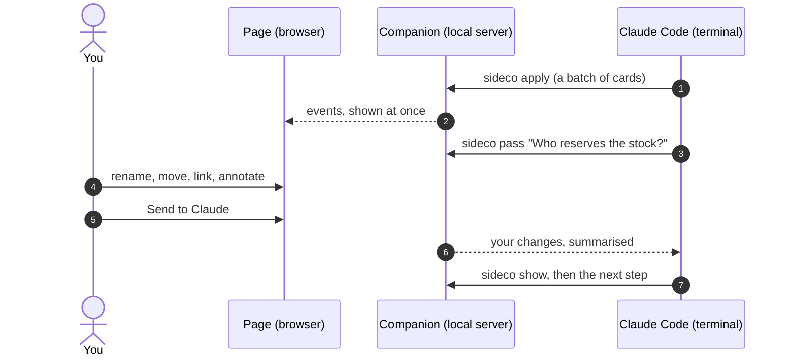
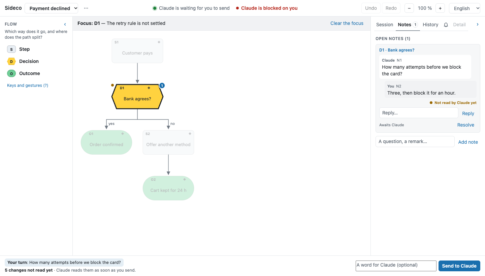
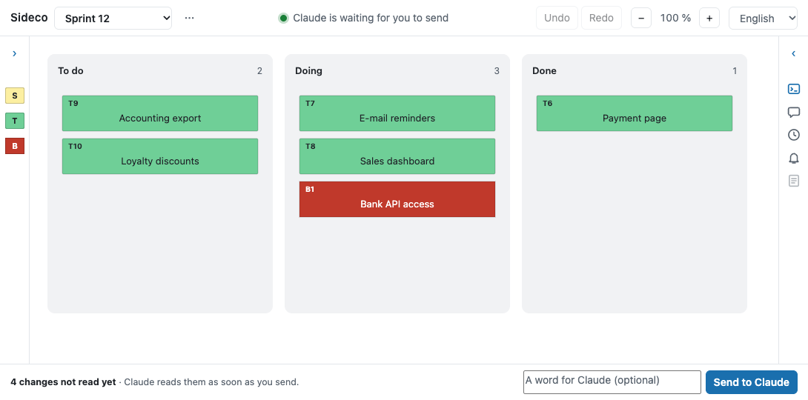
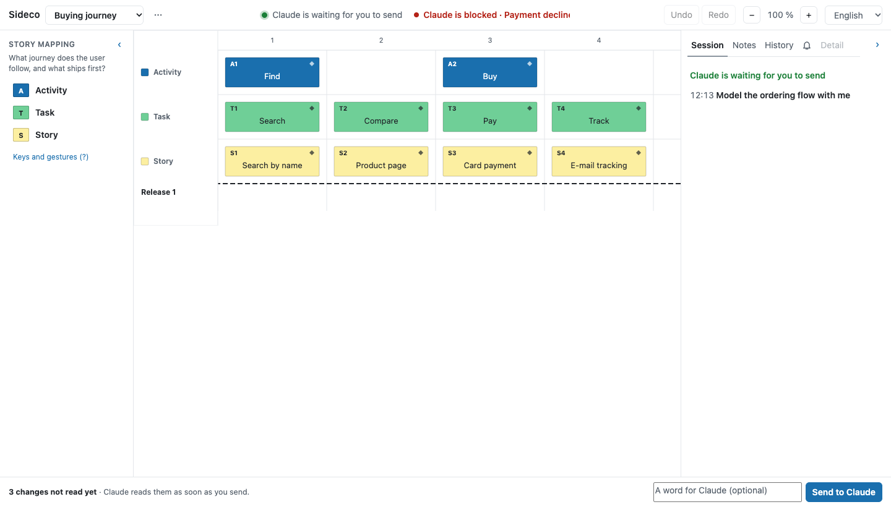
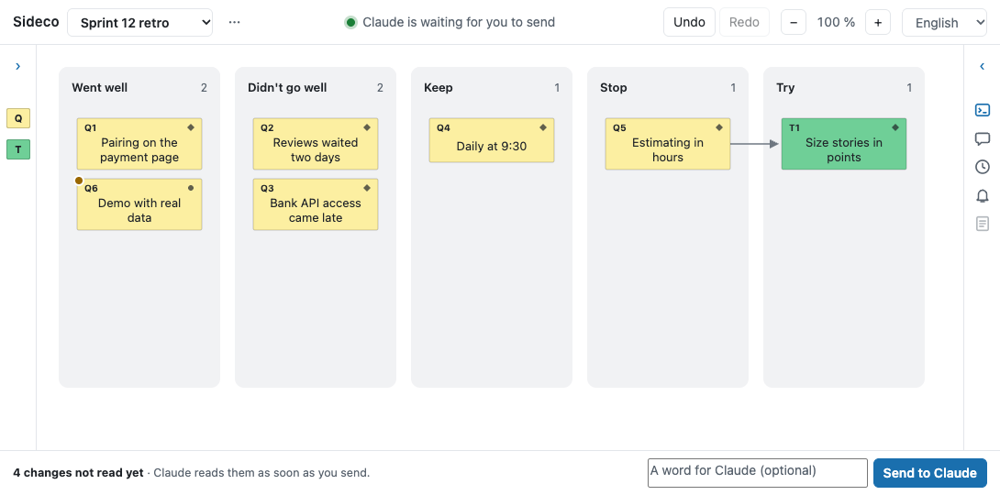
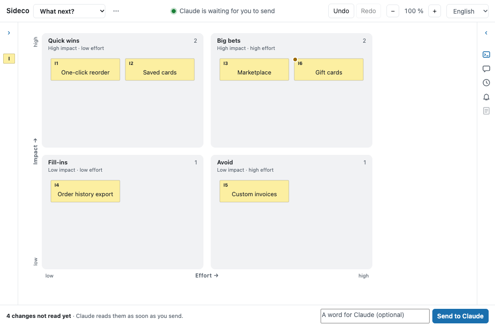
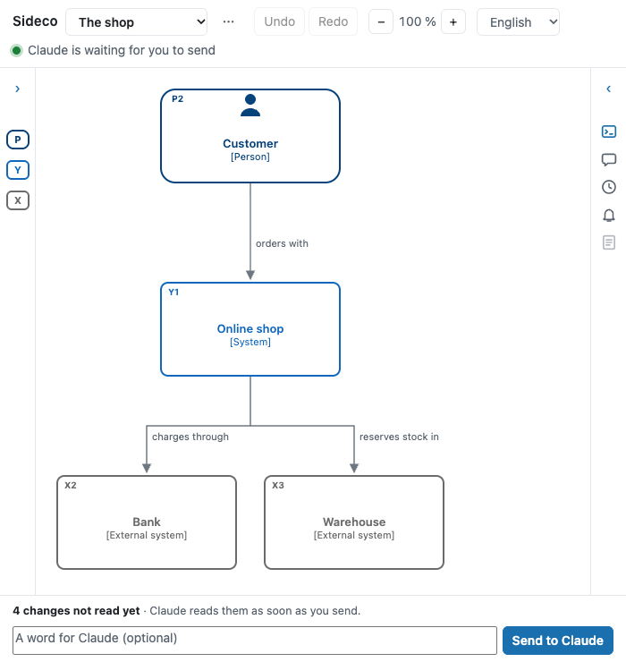

# Sideco · guide

What the [README](../README.md) leaves out. The [guide détaillé](guide.fr.md), in French, goes further: the full CLI, labels, search, the data format.

## Contents

- [Other ways to install](#other-ways-to-install)
- [How a turn travels](#how-a-turn-travels)
- [In the page](#in-the-page)
- [Workshops](#workshops)
- [The commands](#the-commands)
- [With Claude Code's sandbox](#with-claude-codes-sandbox)
- [Known limits](#known-limits)

## Other ways to install

Without Bun yet, install it first, in the same line:

```sh
curl -fsSL https://bun.sh/install | bash && claude plugin marketplace add bastien-gallay/sideco && claude plugin install sideco@sideco
```

To try a clone without installing it, pass the plugin for one session:

```sh
git clone https://github.com/bastien-gallay/sideco.git ~/sideco
claude --plugin-dir ~/sideco
```

To keep the board's address in sight, Claude Code's status line can show `sideco · 127.0.0.1:4747`, a link where the terminal supports one, and nothing outside a Sideco project. A plugin cannot set the status line; ask Claude to run `sideco statusline --install`, which writes it into `~/.claude/settings.json`. A status line of your own is left as it is: the command prints the two lines to append to your script instead.

## How a turn travels

Three parts: Claude Code in the terminal, the companion (a local server started by the plugin), and the page in your browser.



<sub>Source: `src/server/http.ts`, `src/cli/hook.ts`. `tests/e2e/companion.test.ts` checks that a write shows in the page, and that a send wakes Claude, in under 500 ms.</sub>

What Claude receives is net of back-and-forth: a card added then renamed reads as one addition.

## In the page

| Gesture | Effect |
| --- | --- |
| Click a type in the palette | Adds a card of that type |
| Double-click a card | Renames it |
| Drag a card | Moves it to another step or column, or within its cell |
| Select a card | Opens its action bar: rename, detail, link, note for Claude, remove |
| Reply in the Notes tab | Answers Claude in the thread of the card; `⌘` / `Ctrl` + Enter sends the reply and hands the turn back |
| Undo and Redo, or `⌘Z` / `Ctrl+Z` | Takes back your last gesture, never one of Claude's |
| `?` | Lists every key and gesture of the board on screen, and what each mark on a card means |

<picture>
  <source media="(prefers-color-scheme: dark)" srcset="img/sideco-payment-dark.png">
  
</picture>

## Workshops

The name in the first column is the one the `sideco` command takes, as in `sideco board new "Title" --format retro`.

| Format | The question it asks | Cards are placed by |
| --- | --- | --- |
| `event-storming` | What happens in the domain, in what order? | Step |
| `flow` | Which way do we go, and where does the path split? | Link from another card |
| `kanban` | Where is the work, and what blocks it? | Column |
| `story-map` | Which journey, and what do we ship first? | Step |
| `retro` | What do we keep, stop and try? | Column |
| `impact-effort` | What do we do first, for what it brings and what it costs? | Quadrant |
| `c4-context` | Who uses the system, and what does it depend on? | Link from another card |

Event storming and flow are in the README's first picture; the others follow.

<picture>
  <source media="(prefers-color-scheme: dark)" srcset="img/sideco-sprint-dark.png">
  
</picture>

<picture>
  <source media="(prefers-color-scheme: dark)" srcset="img/sideco-journey-dark.png">
  
</picture>

<picture>
  <source media="(prefers-color-scheme: dark)" srcset="img/sideco-retro-dark.png">
  
</picture>

<picture>
  <source media="(prefers-color-scheme: dark)" srcset="img/sideco-next-dark.png">
  
</picture>

<picture>
  <source media="(prefers-color-scheme: dark)" srcset="img/sideco-shop-dark.png">
  
</picture>

<sub>Source: `bun scripts/screenshots.ts docs/img`, which photographs the page as it is.</sub>

## The commands

Claude runs `sideco` for you: in a session, the plugin puts it on the path of the commands Claude runs. Ask in plain words (*"export this board to Markdown"*) or name the command.

| Command | What it does |
| --- | --- |
| `sideco url` | Prints the address of the page, starting the server if it is not running |
| `sideco status` | Lists the boards, the sessions and the server: the output to join to an issue |
| `sideco stop` | Stops the server; the log stays, and the next command starts it again |
| `sideco export BOARD --format md` | Writes one board as Markdown; also `html`, `svg`, `mermaid`, `json`, and `-o FILE` |
| `sideco publish` | Writes every board as a static site under `.sideco/site` |
| `sideco help` | Lists every command, those Claude uses to write a board included |

To type them in your own terminal, work from a clone and link its launcher: `ln -s ~/sideco/bin/sideco ~/.local/bin/sideco`. The [guide détaillé](guide.fr.md#la-ligne-de-commande), in French, describes the whole command line.

<sub>Source: `sideco help`, read on 2026-11-22.</sub>

## With Claude Code's sandbox

By default, the sandbox of Claude Code's Bash tool blocks local connections. The plugin's hooks are not subject to it; the `sideco` commands Claude runs are. Reading (`sideco boards`, `sideco show`) works either way; writing answers `this shell may not connect to the companion`, and Claude runs the command again outside the sandbox, which may ask for your approval.

The setting that avoids it, in Claude Code's `settings.json` (`~/.claude/settings.json` for every project):

```json
{
  "sandbox": {
    "network": { "allowLocalBinding": true }
  }
}
```

<sub>Source: trials of 2026-11-17 and 2026-11-18 in a sandboxed Claude Code 2.1.326 session, recorded in the [guide détaillé](guide.fr.md#avec-le-bac-à-sable-de-claude-code).</sub>

## Known limits

- One person and one active agent per workspace. Two people who edit `.sideco/boards.jsonl` each on their side get a merge conflict.
- The companion stops by itself 5 minutes after the last page and the last session left it; Claude starts it again at the next session.
- A Claude that waited more than 12 hours is no longer woken by a send: the page says so, and it reads your changes at your next message in the terminal.
- A session without an interface (`claude -p`) is never woken by a send.
